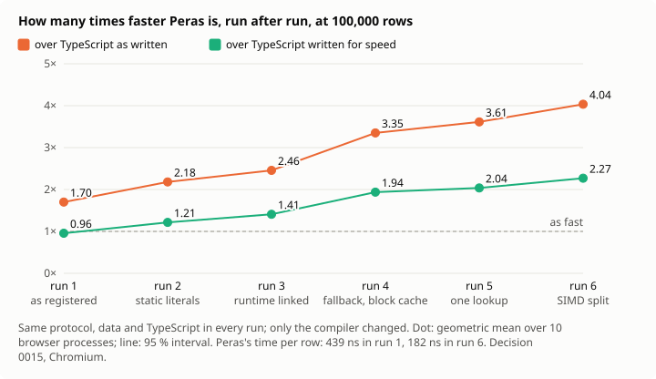

# Peras

_English version: [README.md](README.md), qui fait foi._

Peras est un langage web à la syntaxe TypeScript et à la rigueur de Rust. Les modules `.peras` sont compilés en WebAssembly avec une mémoire exacte, sans ramasse-miettes ; les modules `.apeiron` sont compilés en JavaScript, disciplinés par le compilateur.


_**Avant, après.** Le même coin du jardin d’Apeiron, zoomé 8 puis 64 fois. À gauche, ce que donne une image stockée : le plus petit AVIF de la scène entière qui paraît juste en pleine taille, 9,5 Ko, agrandi ; zoomé 64 fois, 16 de ses pixels remplissent le cadre, et il ne reste rien. À droite, ce que donne le programme Peras, 5,7 Ko : il dessine la fenêtre à ce zoom, et plus on regarde de près, plus il fait de fleurs. Même le PNG sans perte, 471 Ko, n’a que 16 pixels de large à ×64 ; pour égaler le programme là, une image stockée demanderait quelque 41,5 Mo ([décision 0013](docs/fr/decisions/0013-garden-of-apeiron.md), mesuré sous un protocole enregistré avant toute mesure ; `node scripts/garden-showcase.mjs` refait cette image, ses nombres calculés à partir des fichiers)._

**[Zoomez vous-même dans le playground](https://artkabis.github.io/Peras/playground/?lang=fr)** : l’image stockée et le programme côte à côte, jusqu’à 65 536 fois ([source](examples/garden)).

**[Regardez un flux de données lu en direct](https://artkabis.github.io/Peras/stream/?lang=fr)** : des mesures de capteurs en texte CSV, lues par Peras dans un Web Worker à côté du même code en TypeScript simple, les mêmes nombres vérifiés à chaque lot, la vitesse, les centiles et les fuites mesurés pendant qu’il tourne, et exportés en JSON ou en CSV ([comment ça marche](docs/fr/stream.md), [source](examples/stream)).



_**Lire un flux, exécution après exécution.** Le calcul de l’application de flux, mesuré six fois sous un même protocole enregistré avant toute mesure : 10 processus de navigateur, l’ordre des versions croisé, un intervalle à 95 % par un bootstrap hiérarchique ([décision 0015](docs/fr/decisions/0015-stream-measured.md)). Les données, le TypeScript et les seuils sont restés les mêmes ; seul le compilateur a changé, d’après des techniques publiées sur quarante ans ([décision 0016](docs/fr/decisions/0016-faster-from-the-literature.md)). À la première exécution, Peras était 0,96 fois aussi rapide que le TypeScript écrit pour la vitesse à la main. À la sixième, il est 2,01 à 2,27 fois plus rapide, et 3,36 à 4,04 fois plus rapide que le TypeScript tel qu’on l’écrit : 182 ns par ligne, contre 439. Ses appels les plus lents s’écartent encore plus que le seuil enregistré ne le permet, 1,74 fois sa médiane pour 1,5 ([résultats](bench/stream/RESULTS.md), `node scripts/bench-stream.mjs` pour le mesurer à nouveau)._


_Le jardin d’Apeiron, zoomé 1, 8 et 64 fois : une scène dessinée pixel par pixel à partir de quelques règles, qui gagne des détails à mesure qu’on zoome ([décision 0013](docs/fr/decisions/0013-garden-of-apeiron.md)). Ses hypothèses ont été enregistrées avant toute mesure, et ses trois versions, TypeScript, Peras et Rust, donnent les mêmes pixels, bit pour bit. Quatre ont tenu : le programme de 6 Ko est plus petit que le plus petit AVIF de son image à SSIM 0,95, 10 Ko ; zoomée 64 fois, une image stockée demanderait 4 452 fois plus ; chaque format avec perte gagne vu de loin ; les vérifications de débordement coûtent 2 % d’une image. Une a été réfutée : Peras la rend 1,19 fois plus vite que TypeScript, et 1,11 fois plus vite que Rust, en deçà des 1,3 fois enregistrés. Et le même programme en TypeScript se livre cinq fois plus petit que celui de Peras, dont le runtime pèse ([résultats](bench/garden/RESULTS.md))._


_**La bougie et le jardin.** Le même zoom, 40 images du jardin entier jusqu’à une fleur, dessiné par le TypeScript tel qu’on l’écrit souvent (un nouvel objet pour chaque couleur, cellule et pétale), par le TypeScript écrit à la main, et par Peras ; les trois donnent les mêmes pixels, vérifiés image par image. La cire de chaque bougie est le temps de calcul que sa version a dépensé, mesuré dans Chromium, médiane de 5 tours : 26,7 s, 3,3 s et 3,1 s. Peras brûle 8,5 fois moins que le TypeScript souvent écrit, et à peu près autant que le TypeScript écrit à la main. Cette machine compte le temps, pas l’énergie, que le temps entraîne ([résultats](bench/candle/RESULTS.md), `node scripts/candle.mjs` pour le mesurer à nouveau)._


_La même animation, 1,5 million de particules, dans Chromium sur 4 cœurs ([résultats](bench/demo/RESULTS.md), `node scripts/demo.mjs` pour la relancer). À gauche, TypeScript tel qu’on l’écrit souvent, un nouvel objet par particule à chaque image : 8 images par seconde, le tas montant au-delà de 1 Go et retombant à chaque ramassage. Au milieu, TypeScript écrit pour la vitesse à la main, des tableaux typés : 47 images par seconde, plat. À droite, Peras compilé en WebAssembly : 58 images par seconde, la même mémoire que celle de l’expert, plate. Les tableaux typés amènent TypeScript presque jusque-là ; Peras y arrive depuis du code écrit simplement, et va plus loin. Chaque panneau dessine sa propre cadence et sa mémoire, sur une même échelle._

**Là où Peras ne tient pas, mesuré.** Sur l’ingestion de données, un tableau de bord commercial calculé à partir d’un CSV jusqu’à 4 millions de lignes, Peras écrit simplement était plus lent que TypeScript écrit simplement à la première exécution, 0,85 à 0,88 fois sa vitesse. Trois changements du compilateur, trouvés en le profilant, l’ont porté à 1,23 à 1,26 fois à la seconde, en deçà des 2 enregistrés ; il reste huit fois plus lent que TypeScript optimisé à la main, tient plus de mémoire et livre quinze fois plus de code. Cinq des sept hypothèses enregistrées avant la mesure sont réfutées aux deux exécutions ([décision 0014](docs/fr/decisions/0014-data-at-scale.md), [résultats](bench/data/RESULTS.md)) ; l’étude dit ce que le compilateur fait ensuite. Après les décisions [0016](docs/fr/decisions/0016-faster-from-the-literature.md) et [0017](docs/fr/decisions/0017-aggregating-without-copies.md), une quatrième exécution trouve Peras simple 2,39 à 2,63 fois plus rapide que TypeScript simple, au-delà des 2 enregistrés. Le TypeScript optimisé reste 3,2 à 3,9 fois plus rapide que lui, surtout grâce à ce qu’il sait des données, et cinq hypothèses sur sept restent réfutées. Chaque bogue, friction et erreur de méthode trouvé en chemin est consigné dans [les constats](docs/fr/findings.md).

> Peras (πέρας) signifie _la limite_ en grec. Pour les pythagoriciens, tout ce qui est bon naît de la limite imposée à l'illimité (_apeiron_).

**État :** version 0.0.1, en phase 3 de la [feuille de route](docs/fr/reference/roadmap.md), la bibliothèque standard ([journal des modifications](CHANGELOG.fr.md), [ce qui est compilé aujourd’hui](docs/fr/reference/status.md)). `perasc` vérifie la syntaxe, les noms, les types et la possession d’une source, et la compile en WebAssembly sans toolchain Rust : nombres, structures, énumérations et `match`, options et résultats, génériques, méthodes et interfaces, tableaux et chaînes avec leurs méthodes, fonctions fléchées pour `map`, `filter` et les autres, chaînes gabarits, `Map` et `Set`, et des boucles `parallel for` sur tous les cœurs avec `--threads on`. Chaque bloc de mémoire est libéré par le compilateur, vérifié par un vérificateur, avec un allocateur de débogage en développement et TLSF en production. `vite-plugin-peras` exécute les modules dans le navigateur. Les modules `.apeiron` se compilent en JavaScript, avec `async` et `await`, et appellent les modules `.peras` ([modules managed](docs/fr/guide/managed.md)) ; le navigateur typé vient ensuite.

**Vitesse**, mesurée dans Chromium face à du JavaScript écrit pour la vitesse ([banc d’essai](bench/README.fr.md#banc-dessai-dans-le-navigateur-benchbrowser)) : 5,4 fois plus rapide sur les entiers 64 bits, 1,6 à 2,4 fois sur les nombres en tableaux, le tri et le texte, la même vitesse sur les structures et l’arithmétique flottante seule, et plus lent sur les appels très courts à travers la frontière. Face à JavaScript tel qu’on l’écrit habituellement, les écarts sont plus grands ; les deux sont publiés. Face à Rust et AssemblyScript tels qu’on les écrit habituellement, Peras va à la vitesse de Rust, devant lui sur quatre noyaux où son compilateur en fait plus, et plus vite qu’AssemblyScript partout où entrent des tableaux ou des allocations.

## Piliers

1. **Rasterisation** : framebuffers typés partagés avec le Canvas sans copie.
2. **Mémoire** : propriété unique, libération déterministe, aucune allocation dans une boucle de rendu.
3. **Syntaxe accessible** : un développeur TypeScript est productif en une journée.

Chaque diagnostic bloque le build et explique la cause, l'historique de la valeur et la correction, en anglais ou en français.

## Documentation

Le site, avec recherche, en français et en anglais : **<https://artkabis.github.io/Peras/>**, construit depuis `docs/` à chaque push sur `main`. Pour une première décision : [Peras pour les décideurs](docs/fr/guide/overview.md).

- [Guide](docs/fr/guide/introduction.md), du premier programme à l’échange avec JavaScript
- [Référence](docs/fr/reference/status.md) : état, types, opérateurs, méthodes, mots-clés, CLI, [feuille de route](docs/fr/reference/roadmap.md)
- [Codes d’erreur](docs/fr/errors/index.md), chacun avec sa cause et sa correction
- Décisions : [0001 backend WebAssembly](docs/fr/decisions/0001-webassembly-backend.md), [0002 allocateur TLSF](docs/fr/decisions/0002-tlsf-allocator.md), [0003 un runtime prouvé à la compilation](docs/fr/decisions/0003-runtime-proved-at-compile-time.md), [0004 du texte sans allocation](docs/fr/decisions/0004-strings-without-allocation.md), [0005 tables et ensembles](docs/fr/decisions/0005-maps-and-sets.md), [0006 licences](docs/fr/decisions/0006-licensing.md), [0007 threads sur mémoire partagée](docs/fr/decisions/0007-threads-over-shared-memory.md), [0008 le mode managed](docs/fr/decisions/0008-managed-mode.md), [0009 le navigateur et les ressources](docs/fr/decisions/0009-browser-and-resources.md), [0010 appeler JavaScript](docs/fr/decisions/0010-calling-javascript.md), [0011 que construire ensuite, décidé par la mesure](docs/fr/decisions/0011-what-to-build-next.md), [0012 le coût sur la machine, mesuré à chaque étape](docs/fr/decisions/0012-cost-on-the-machine.md), [0013 le jardin d’Apeiron, une scène procédurale mesurée](docs/fr/decisions/0013-garden-of-apeiron.md), [0014 la donnée à l’échelle, agrégée dans le navigateur (protocole)](docs/fr/decisions/0014-data-at-scale.md), [0015 l’application de flux, mesurée](docs/fr/decisions/0015-stream-measured.md), [0016 rendre le compilateur plus rapide, d’après ce qui a été mesuré et ce qui est publié](docs/fr/decisions/0016-faster-from-the-literature.md), [0017 agréger sans copies](docs/fr/decisions/0017-aggregating-without-copies.md), [0018 les grandes tables](docs/fr/decisions/0018-large-maps.md), [0019 lire les champs d’une ligne (proposée)](docs/fr/decisions/0019-reading-fields.md) ; [la recherche derrière Peras](docs/fr/research.md), chaque choix avec les travaux publiés sur lesquels il repose
- [Bancs d’essai](bench/README.fr.md), ce qu’ils mesurent et ce qu’ils ne mesurent pas
- [Spec du langage](docs/fr/spec.md), [architecture](docs/fr/architecture.md), [plan de démarrage du compilateur](docs/fr/kickoff-plan.md)

## Organisation du dépôt

| Chemin                       | Contenu                                              |
| ---------------------------- | ---------------------------------------------------- |
| `crates/perasc-syntax`       | Lexer, parser, AST                                   |
| `crates/perasc-diag`         | Diagnostics, codes d'erreur, messages EN/FR          |
| `crates/perasc-check`        | Noms, types, ownership, ressources, budget de pile   |
| `crates/perasc-ir`           | IR typée partagée par les deux backends              |
| `crates/perasc-codegen-rs`   | `.peras` → Rust → WASM                               |
| `crates/perasc-codegen-wasm` | `.peras` → WASM, en direct, sans toolchain Rust      |
| `crates/perasc-codegen-js`   | `.apeiron` → JavaScript                              |
| `crates/perasc-driver`       | Pipeline et orchestration du build                   |
| `crates/perasc-runtime`      | Runtime WebAssembly : allocateurs, chaînes, tableaux |
| `crates/perasc`              | Interface en ligne de commande                       |
| `packages/vite-plugin-peras` | Plugin Vite                                          |
| `packages/vitest-peras`      | Adaptateur Vitest                                    |
| `packages/create-peras`      | Création de projet                                   |
| `examples/fib`               | `fib` en Peras, exécuté dans le navigateur via Vite  |
| `std/`                       | Bibliothèque standard, écrite en Peras               |
| `tests/ui/`                  | Fichiers source et leurs diagnostics attendus        |
| `docs/en`, `docs/fr`         | Documentation, anglais d'abord                       |

## Démarrer

Prérequis : [rustup](https://rustup.rs), Node 26 LTS (26.13.0+), pnpm 12+.

```sh
# Rust : rustup installe le toolchain épinglé dans rust-toolchain.toml
cargo test --workspace
cargo run -p perasc -- --version

# Vérifier des sources : chaque erreur avec extrait, cause et correction (--lang en|fr, --json)
cargo run -p perasc -- check crates/perasc/tests/fixtures/demo.peras --lang fr
cargo run -p perasc -- explain E0007 --lang fr

# JS : une fois, installe les dernières dépendances de dev stables et mûres (publiées depuis plus de 24 h), les audite et lance tous les contrôles
pnpm run bootstrap
```

Avant le premier push, commite le `pnpm-lock.yaml` créé par le bootstrap : la CI l'installe en mode figé.

## Exécuter Peras dans le navigateur

```sh
cargo build --release -p perasc
pnpm --filter peras-example-fib dev
```

`examples/fib/src/main.ts` importe `fib` depuis `fib.peras` comme n’importe quel module. `vite-plugin-peras` le compile avec le backend direct de `perasc` : en développement, le WebAssembly est intégré au module, et `vite build` l’émet comme un fichier à empreinte, compilé pendant son téléchargement. Une erreur dans la source s’affiche dans l’overlay de Vite avec son extrait, sa cause et sa correction, et fait échouer `vite build`. Le plugin écrit aussi `fib.d.peras.ts` à côté de la source, pour que TypeScript connaisse les vraies signatures (avec `allowArbitraryExtensions`).

```ts
// vite.config.ts
import peras from "vite-plugin-peras";

export default { plugins: [peras({ perasc: "chemin/vers/perasc", lang: "fr" })] };
```

`pnpm run e2e` construit l’exemple, l’ouvre dans un Chromium sans interface sur le serveur de développement et sur le build de production, et vérifie que l’overlay affiche les erreurs. Il faut `target/release/perasc` et un Chromium : `pnpm exec playwright install chromium`, ou `PERAS_CHROMIUM` pointant vers un Chromium installé.

## Contribuer

Voir [CONTRIBUTING.fr.md](CONTRIBUTING.fr.md). En bref : anglais d'abord, puis français dans la même pull request ; aucun avertissement, aucun `unsafe`, aucune CVE connue.

## Licence

Peras est un logiciel libre sous [GNU Affero General Public License, version 3 ou ultérieure](LICENSE), avec l’[exception de runtime de Peras](RUNTIME-EXCEPTION.fr.md) : les programmes que vous compilez avec Peras vous appartiennent, aux conditions de votre choix, fermées comprises ; Peras lui-même, modifié ou non, reste sous AGPL, y compris proposé comme service. Les exemples de code de la documentation et de `examples/` sont sous 0BSD. L’analyseur de fuites mémoire et l’extension VS Code sont des outils séparés et propriétaires. Pourquoi : [décision 0006](docs/fr/decisions/0006-licensing.md).

Copyright © 2026 Artkabis et les contributeurs de Peras.
