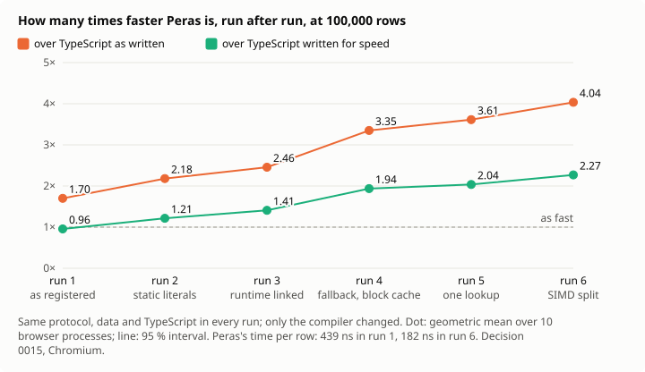

# Peras

_Version française : [README.fr.md](README.fr.md)_

Peras is a web language with TypeScript syntax and Rust-grade rigour. `.peras` modules compile to WebAssembly with exact, garbage-collector-free memory; `.apeiron` modules compile to JavaScript, disciplined by the compiler.


_**Before, after.** The same corner of the garden of Apeiron, zoomed 8 then 64 times. Left, what a stored image gives: the smallest AVIF of the whole scene that looks right at full size, 9.5 KB, enlarged; zoomed 64 times, 16 pixels of it fill the frame, and nothing is left. Right, what the Peras program gives, 5.7 KB: it draws the window at that zoom, and the closer you look, the more flowers it makes. Even the lossless PNG, 471 KB, has only 16 pixels across at ×64; to match the program there, a stored image would need some 41.5 MB ([decision 0013](docs/en/decisions/0013-garden-of-apeiron.md), measured under a protocol registered before any measure; `node scripts/garden-showcase.mjs` makes this image again, its numbers computed from the files)._

**[Zoom into it yourself in the playground](https://artkabis.github.io/Peras/playground/)**: the stored image and the program side by side, down to 65,536 times ([source](examples/garden)).

**[Watch a stream of data read live](https://artkabis.github.io/Peras/stream/)**: sensor readings as CSV text, read by Peras in a Web Worker beside the same code in plain TypeScript, the same numbers checked in every batch, the speed, percentiles and leaks measured as it runs, and exported as JSON or CSV ([how it works](docs/en/stream.md), [source](examples/stream)).



_**Reading a stream, run after run.** The stream app's digest, measured six times under one protocol registered before any measure: 10 browser processes, the order of the versions crossed, a 95 % interval by a hierarchical bootstrap ([decision 0015](docs/en/decisions/0015-stream-measured.md)). The data, the TypeScript and the thresholds stayed the same; only the compiler changed, from techniques published over forty years ([decision 0016](docs/en/decisions/0016-faster-from-the-literature.md)). In the first run, Peras was 0.96 times as fast as TypeScript written for speed by hand. In the sixth, it is 2.01 to 2.27 times as fast, and 3.36 to 4.04 times as fast as TypeScript as written: 182 ns per row, against 439. Its slowest calls still spread more than the registered threshold allows, 1.74 times its median for 1.5 ([results](bench/stream/RESULTS.md), `node scripts/bench-stream.mjs` to measure it again)._


_The garden of Apeiron, zoomed 1, 8 and 64 times: a scene drawn pixel by pixel from a few rules, that gains detail as it is zoomed ([decision 0013](docs/en/decisions/0013-garden-of-apeiron.md)). Its hypotheses were registered before any measure, and its three versions, TypeScript, Peras and Rust, give the same pixels, bit for bit. Four held: the 6 KB program is smaller than the smallest AVIF of its image at SSIM 0.95, 10 KB; zoomed 64 times, a stored image would need 4,452 times more; every lossy format scores higher seen from afar; the overflow checks cost 2 % of a frame. One was refuted: Peras renders it 1.19 times as fast as TypeScript, and 1.11 times as fast as Rust, short of the 1.3 times registered. And the same program in TypeScript ships five times smaller than Peras's, whose runtime weighs ([results](bench/garden/RESULTS.md))._


_**The candle and the garden.** The same zoom, 40 frames from the whole garden to a flower, drawn by TypeScript as often written (a new object for each colour, cell and petal), by TypeScript written by hand, and by Peras; the three give the same pixels, checked frame by frame. Each candle's wax is the processor time its version has spent, measured in Chromium, median of 5 rounds: 26.7 s, 3.3 s and 3.1 s. Peras burns 8.5 times less than the TypeScript often written, and about as much as the TypeScript written by hand. This machine counts time, not energy, which time drives ([results](bench/candle/RESULTS.md), `node scripts/candle.mjs` to measure it again)._


_The same animation, 1.5 million particles, in Chromium on 4 cores ([results](bench/demo/RESULTS.md), `node scripts/demo.mjs` to run it again). Left, TypeScript as it is often written, a new object per particle at each frame: 8 frames a second, the heap climbing past 1 GB and falling at each collection. Middle, TypeScript written for speed by hand, typed arrays: 47 frames a second, flat. Right, Peras compiled to WebAssembly: 58 frames a second, the same memory as the expert's, flat. Typed arrays bring TypeScript most of the way; Peras gets there from code written plainly, and the rest of the way. Each panel draws its own frame rate and memory, on one scale._

**Where Peras falls short, measured.** On ingesting data, a sales dashboard computed from a CSV of up to 4 million rows, Peras written plainly was slower than TypeScript written plainly in the first run, 0.85 to 0.88 times its speed. Three changes to the compiler, found by profiling it, brought it to 1.23 to 1.26 times in the second, short of the 2 registered; it stays eight times slower than TypeScript optimized by hand, holds more memory and ships fifteen times more code. Five of seven hypotheses registered before the measure are refuted in both runs ([decision 0014](docs/en/decisions/0014-data-at-scale.md), [results](bench/data/RESULTS.md)); the study names what the compiler does next. After decisions [0016](docs/en/decisions/0016-faster-from-the-literature.md), [0017](docs/en/decisions/0017-aggregating-without-copies.md) and [0020](docs/en/decisions/0020-text-as-bytes.md), a fifth run finds plain Peras 2.52 to 3.00 times as fast as plain TypeScript, past the 2 registered, and its peak memory 0.23 times plain TypeScript's, where half was registered. Optimized TypeScript stays 2.8 to 3.6 times faster than it, most of that from what it knows of the data; four hypotheses of seven are still refuted. Every bug, friction and error of method found along the way is kept in [the findings](docs/en/findings.md).

> Peras (πέρας) is Greek for _the limit_. For the Pythagoreans, everything good arises from limit imposed on the unlimited (_apeiron_).

**Status:** version 0.0.1, in phase 3 of the [roadmap](docs/en/reference/roadmap.md), the standard library ([changelog](CHANGELOG.md), [what is compiled today](docs/en/reference/status.md)). `perasc` checks the syntax, names, types and ownership of a source, and compiles it to WebAssembly without a Rust toolchain: numbers, structures, enumerations and `match`, options and results, generics, methods and interfaces, arrays and strings with their methods, arrow functions for `map`, `filter` and the others, template literals, `Map` and `Set`, and `parallel for` loops on every core with `--threads on`. Every block of memory is released by the compiler, checked by a verifier, with a debug allocator in development and TLSF in production. `vite-plugin-peras` runs modules in the browser. `.apeiron` modules compile to JavaScript, with `async` and `await`, and call `.peras` modules ([managed modules](docs/en/guide/managed.md)); the typed browser comes next.

**Speed**, measured in Chromium against JavaScript written for speed ([benchmark](bench/README.md#browser-benchmark-benchbrowser)): 5.4 times faster on 64-bit integers, 1.6 to 2.4 times on numbers in arrays, sorting and text, the same speed on structures and floating-point arithmetic alone, and slower on very short calls across the boundary. Against JavaScript as usually written, the gaps are larger; both are published. Against Rust and AssemblyScript as usually written, Peras runs at the speed of Rust, ahead of it on four kernels where its compiler does more, and faster than AssemblyScript wherever arrays or allocation are involved.

## Pillars

1. **Rasterization**: typed framebuffers shared with the Canvas without copying.
2. **Memory**: single ownership, deterministic release, no allocation inside a render loop.
3. **Approachable syntax**: TypeScript developers are productive within a day.

Every diagnostic blocks the build and explains the cause, the value's history and the fix, in English or French.

## Documentation

The site, with search, in English and French: **<https://artkabis.github.io/Peras/>**, built from `docs/` on every push to `main`. For a first decision: [Peras for decision-makers](docs/en/guide/overview.md).

- [Guide](docs/en/guide/introduction.md), from the first program to JavaScript interop
- [Reference](docs/en/reference/status.md): status, types, operators, methods, keywords, CLI, [roadmap](docs/en/reference/roadmap.md)
- [Error codes](docs/en/errors/index.md), each with its cause and fix
- Decisions: [0001 WebAssembly backend](docs/en/decisions/0001-webassembly-backend.md), [0002 TLSF allocator](docs/en/decisions/0002-tlsf-allocator.md), [0003 a runtime proved at compile time](docs/en/decisions/0003-runtime-proved-at-compile-time.md), [0004 strings without allocation](docs/en/decisions/0004-strings-without-allocation.md), [0005 maps and sets](docs/en/decisions/0005-maps-and-sets.md), [0006 licensing](docs/en/decisions/0006-licensing.md), [0007 threads over shared memory](docs/en/decisions/0007-threads-over-shared-memory.md), [0008 managed mode](docs/en/decisions/0008-managed-mode.md), [0009 the browser and resources](docs/en/decisions/0009-browser-and-resources.md), [0010 calling JavaScript](docs/en/decisions/0010-calling-javascript.md), [0011 what to build next, decided by measurement](docs/en/decisions/0011-what-to-build-next.md), [0012 the cost on the machine, measured with every step](docs/en/decisions/0012-cost-on-the-machine.md), [0013 the garden of Apeiron, a procedural scene measured](docs/en/decisions/0013-garden-of-apeiron.md), [0014 data at scale, aggregated in the browser (protocol)](docs/en/decisions/0014-data-at-scale.md), [0015 the stream app, measured](docs/en/decisions/0015-stream-measured.md), [0016 making the compiler faster, from what was measured and what is published](docs/en/decisions/0016-faster-from-the-literature.md), [0017 aggregating without copies](docs/en/decisions/0017-aggregating-without-copies.md), [0018 large maps](docs/en/decisions/0018-large-maps.md), [0019 reading the fields of a line](docs/en/decisions/0019-reading-fields.md), [0020 text given as bytes](docs/en/decisions/0020-text-as-bytes.md), [0021 phases 4 and 5, and the gaps of the language (plan)](docs/en/decisions/0021-phases-4-and-5.md), [0022 owned modules that import each other](docs/en/decisions/0022-owned-modules.md), [0023 module variables in owned modules (proposed)](docs/en/decisions/0023-module-variables.md); [the research behind Peras](docs/en/research.md), each choice with the published work it rests on
- [Benchmarks](bench/README.md), what they measure and what they do not
- [Language spec](docs/en/spec.md), [architecture](docs/en/architecture.md), [compiler kickoff plan](docs/en/kickoff-plan.md)

## Repository layout

| Path                         | Contents                                            |
| ---------------------------- | --------------------------------------------------- |
| `crates/perasc-syntax`       | Lexer, parser, AST                                  |
| `crates/perasc-diag`         | Diagnostics, error codes, EN/FR messages            |
| `crates/perasc-check`        | Names, types, ownership, resources, stack budget    |
| `crates/perasc-ir`           | Typed IR shared by both backends                    |
| `crates/perasc-codegen-rs`   | `.peras` → Rust → WASM                              |
| `crates/perasc-codegen-wasm` | `.peras` → WASM, directly, without a Rust toolchain |
| `crates/perasc-codegen-js`   | `.apeiron` → JavaScript                             |
| `crates/perasc-driver`       | Pipeline and build orchestration                    |
| `crates/perasc-runtime`      | WebAssembly runtime: allocators, strings, arrays    |
| `crates/perasc`              | Command-line interface                              |
| `packages/vite-plugin-peras` | Vite plugin                                         |
| `packages/vitest-peras`      | Vitest adapter                                      |
| `packages/create-peras`      | Project scaffolding                                 |
| `examples/fib`               | `fib` in Peras, run in the browser through Vite     |
| `std/`                       | Standard library, written in Peras                  |
| `tests/ui/`                  | Source files and their expected diagnostics         |
| `docs/en`, `docs/fr`         | Documentation, English first                        |

## Getting started

Requirements: [rustup](https://rustup.rs), Node 26 LTS (26.13.0+), pnpm 12+.

```sh
# Rust: rustup installs the toolchain pinned in rust-toolchain.toml
cargo test --workspace
cargo run -p perasc -- --version

# Check sources: every error with excerpt, cause and fix (--lang en|fr, --json)
cargo run -p perasc -- check crates/perasc/tests/fixtures/demo.peras
cargo run -p perasc -- explain E0007

# JS: once, installs the newest mature (>24 h old) stable dev dependencies, audits them and runs every check
pnpm run bootstrap
```

Before the first push, commit the `pnpm-lock.yaml` created by the bootstrap: CI installs it frozen.

## Run Peras in the browser

```sh
cargo build --release -p perasc
pnpm --filter peras-example-fib dev
```

`examples/fib/src/main.ts` imports `fib` from `fib.peras` like any module. `vite-plugin-peras` compiles it with `perasc`'s direct backend: in development the WebAssembly is inlined in the module, and `vite build` emits it as a hashed asset, compiled while it downloads. An error in the source shows in Vite's overlay with its excerpt, cause and fix, and fails `vite build`. The plugin also writes `fib.d.peras.ts` next to the source, so TypeScript knows the real signatures (with `allowArbitraryExtensions`).

```ts
// vite.config.ts
import peras from "vite-plugin-peras";

export default { plugins: [peras({ perasc: "path/to/perasc", lang: "en" })] };
```

`pnpm run e2e` builds the example, opens it in a headless Chromium on the dev server and on the production build, and checks the overlay shows errors. It needs `target/release/perasc` and a Chromium: `pnpm exec playwright install chromium`, or `PERAS_CHROMIUM` set to an installed one.

## Contributing

See [CONTRIBUTING.md](CONTRIBUTING.md). In short: English first, then French in the same pull request; no warning, no `unsafe`, no known CVE.

## Licence

Peras is free software under the [GNU Affero General Public License, version 3 or later](LICENSE), with the [Peras Runtime Exception](RUNTIME-EXCEPTION.md): the programs you compile with Peras are yours, under the terms you choose, closed ones included; Peras itself, modified or not, stays under the AGPL, as a service too. The code examples of the documentation and of `examples/` are under 0BSD. The memory leak analyzer and the VS Code extension are separate, proprietary tools. Why: [decision 0006](docs/en/decisions/0006-licensing.md).

Copyright © 2026 Artkabis and the Peras contributors.
