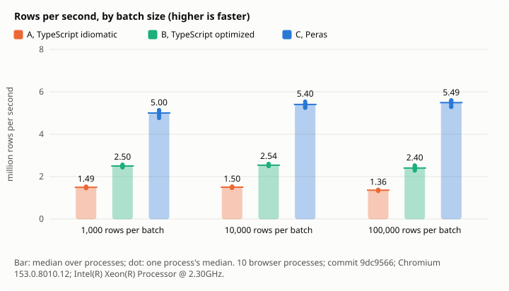
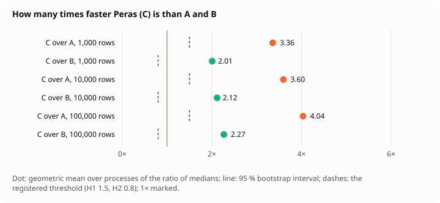
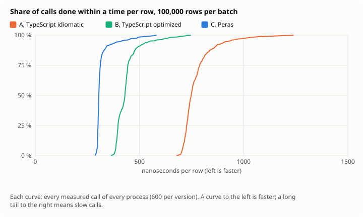
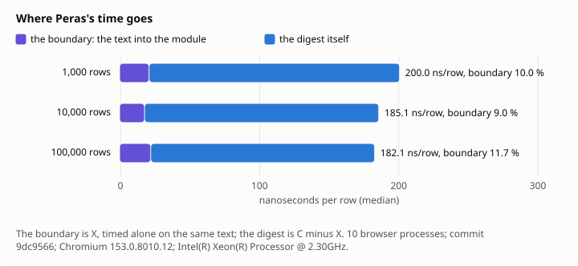

# Decision 0015: results

Measured at commit `9dc9566`, 2026-11-12, under [the protocol](../../docs/en/decisions/0015-stream-measured.md). Every number below is in [results.json](results.json), with every call's time.

- Machine: Intel(R) Xeon(R) Processor @ 2.30GHz, 4 cores, linux 6.18.44-fc-v378; Chromium 153.0.8010.12; Node v24.22.1.
- Design: 10 browser processes; batches of 1000, 10000, 100000 rows; the calls in a Latin square of 4 orders; 95 % intervals by a hierarchical bootstrap of 10000 resamples, seed 15.
- Clock: cross-origin isolated true, its step at most 5.0 µs.
- Agreement: every batch of every pool gave the same digest in A, B and C, and C refused exactly the lines broken on purpose.

## Hypotheses

| | Registered | Measured, 95 % interval | Verdict |
| --- | --- | --- | --- |
| H1 | C at least 1.5 times as fast as A, at 10,000 and 100,000 rows | 3.60 [3.55, 3.64]; 4.04 [4.00, 4.08] | holds |
| H2 | C at least 0.8 times as fast as B, at 10,000 and 100,000 rows | 2.12 [2.10, 2.13]; 2.27 [2.23, 2.31] | holds |
| H3 | C's rows per second at 1,000 rows at least 0.75 times those at 100,000 | 0.91 [0.89, 0.94] | holds |
| H4 | The boundary at most 15 % of C's time at 100,000 rows | 0.12 [0.11, 0.12] | holds |
| H5 | C's 99th percentile at most 1.5 times its median at 100,000 rows | 1.74 [1.66, 1.81] | refuted |

## Time per batch

The median over processes of each process's median, in ms; rows per second from it; the spread of the process medians; the percentiles of all calls pooled.

| Rows | Version | Median ms | Min–max ms | CV | p95 ms | p99 ms | Rows/s | ns/row |
| ---: | --- | ---: | ---: | ---: | ---: | ---: | ---: | ---: |
| 1,000 | A, TypeScript idiomatic | 0.67 | 0.65–0.69 | 1.4 % | 1.08 | 1.24 | 1,492,537 | 670.0 |
| 1,000 | B, TypeScript optimized | 0.40 | 0.39–0.41 | 1.6 % | 0.63 | 0.73 | 2,500,000 | 400.0 |
| 1,000 | C, Peras | 0.20 | 0.20–0.21 | 2.6 % | 0.35 | 0.41 | 5,000,000 | 200.0 |
| 1,000 | X, the boundary alone | 0.02 | 0.02–0.02 | 0.0 % | 0.04 | 0.05 | 50,000,000 | 20.0 |
| 10,000 | A, TypeScript idiomatic | 6.67 | 6.54–6.83 | 1.5 % | 7.53 | 10.69 | 1,498,969 | 667.1 |
| 10,000 | B, TypeScript optimized | 3.94 | 3.85–4.01 | 1.2 % | 4.32 | 6.28 | 2,535,658 | 394.4 |
| 10,000 | C, Peras | 1.85 | 1.80–1.91 | 1.7 % | 2.10 | 3.10 | 5,401,756 | 185.1 |
| 10,000 | X, the boundary alone | 0.17 | 0.16–0.17 | 2.1 % | 0.29 | 0.35 | 59,701,493 | 16.7 |
| 100,000 | A, TypeScript idiomatic | 73.73 | 72.42–75.83 | 1.1 % | 93.60 | 115.22 | 1,356,231 | 737.3 |
| 100,000 | B, TypeScript optimized | 41.63 | 39.58–43.78 | 3.2 % | 52.97 | 66.52 | 2,402,042 | 416.3 |
| 100,000 | C, Peras | 18.21 | 17.85–18.91 | 2.0 % | 28.68 | 31.79 | 5,489,981 | 182.1 |
| 100,000 | X, the boundary alone | 2.12 | 2.02–2.18 | 2.5 % | 2.98 | 3.51 | 47,114,252 | 21.2 |

## Ratios

| Rows | C over A | C over B | B over A | C's boundary share | C's p99 / p50 |
| ---: | ---: | ---: | ---: | ---: | ---: |
| 1,000 | 3.36 [3.30, 3.41] | 2.01 [1.98, 2.03] | 1.67 [1.66, 1.69] | 0.10 [0.10, 0.10] | 2.07 [1.90, 2.22] |
| 10,000 | 3.60 [3.55, 3.64] | 2.12 [2.10, 2.13] | 1.70 [1.68, 1.71] | 0.09 [0.09, 0.09] | 1.66 [1.54, 1.94] |
| 100,000 | 4.04 [4.00, 4.08] | 2.27 [2.23, 2.31] | 1.78 [1.75, 1.81] | 0.12 [0.11, 0.12] | 1.74 [1.66, 1.81] |

## Figures

