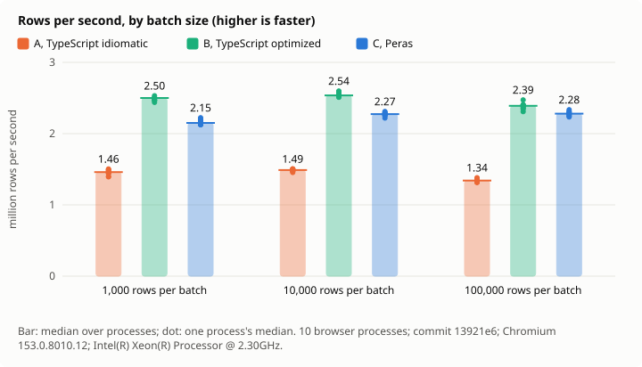
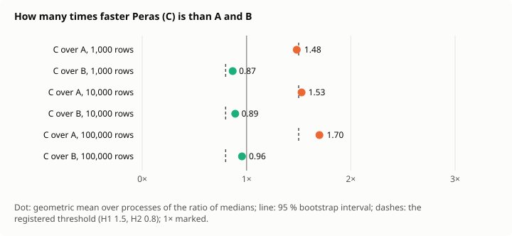
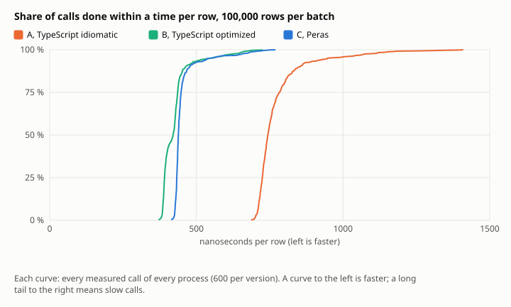
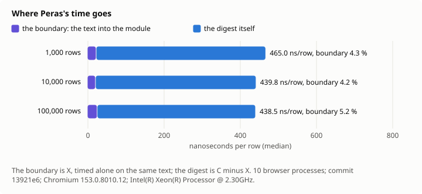

# Decision 0015: results

Measured at commit `13921e6`, 2026-11-11, under [the protocol](../../../docs/en/decisions/0015-stream-measured.md). Every number below is in [results.json](results.json), with every call's time.

- Machine: Intel(R) Xeon(R) Processor @ 2.30GHz, 4 cores, linux 6.18.44-fc-v378; Chromium 153.0.8010.12; Node v24.22.1.
- Design: 10 browser processes; batches of 1000, 10000, 100000 rows; the calls in a Latin square of 4 orders; 95 % intervals by a hierarchical bootstrap of 10000 resamples, seed 15.
- Clock: cross-origin isolated true, its step at most 5.0 µs.
- Agreement: every batch of every pool gave the same digest in A, B and C, and C refused exactly the lines broken on purpose.

## Hypotheses

| | Registered | Measured, 95 % interval | Verdict |
| --- | --- | --- | --- |
| H1 | C at least 1.5 times as fast as A, at 10,000 and 100,000 rows | 1.53 [1.52, 1.54]; 1.70 [1.68, 1.71] | holds |
| H2 | C at least 0.8 times as fast as B, at 10,000 and 100,000 rows | 0.89 [0.88, 0.90]; 0.96 [0.93, 0.97] | holds |
| H3 | C's rows per second at 1,000 rows at least 0.75 times those at 100,000 | 0.94 [0.93, 0.96] | holds |
| H4 | The boundary at most 15 % of C's time at 100,000 rows | 0.05 [0.05, 0.05] | holds |
| H5 | C's 99th percentile at most 1.5 times its median at 100,000 rows | 1.61 [1.48, 1.70] | undetermined |

## Time per batch

The median over processes of each process's median, in ms; rows per second from it; the spread of the process medians; the percentiles of all calls pooled.

| Rows | Version | Median ms | Min–max ms | CV | p95 ms | p99 ms | Rows/s | ns/row |
| ---: | --- | ---: | ---: | ---: | ---: | ---: | ---: | ---: |
| 1,000 | A, TypeScript idiomatic | 0.68 | 0.67–0.72 | 2.7 % | 1.08 | 1.37 | 1,459,854 | 685.0 |
| 1,000 | B, TypeScript optimized | 0.40 | 0.40–0.41 | 1.0 % | 0.63 | 0.72 | 2,500,000 | 400.0 |
| 1,000 | C, Peras | 0.47 | 0.45–0.47 | 1.5 % | 0.73 | 0.84 | 2,150,538 | 465.0 |
| 1,000 | X, the boundary alone | 0.02 | 0.02–0.02 | 0.0 % | 0.04 | 0.06 | 50,000,000 | 20.0 |
| 10,000 | A, TypeScript idiomatic | 6.72 | 6.65–6.87 | 1.1 % | 8.64 | 11.62 | 1,488,372 | 671.9 |
| 10,000 | B, TypeScript optimized | 3.94 | 3.85–3.98 | 1.2 % | 4.77 | 6.48 | 2,536,462 | 394.2 |
| 10,000 | C, Peras | 4.40 | 4.33–4.51 | 1.2 % | 5.41 | 7.19 | 2,274,019 | 439.8 |
| 10,000 | X, the boundary alone | 0.18 | 0.17–0.22 | 10.1 % | 0.33 | 0.39 | 54,794,521 | 18.3 |
| 100,000 | A, TypeScript idiomatic | 74.59 | 72.42–76.05 | 1.7 % | 94.69 | 117.72 | 1,340,662 | 745.9 |
| 100,000 | B, TypeScript optimized | 41.84 | 40.44–43.31 | 1.8 % | 54.61 | 66.32 | 2,389,915 | 418.4 |
| 100,000 | C, Peras | 43.85 | 42.82–44.77 | 1.3 % | 54.70 | 70.41 | 2,280,502 | 438.5 |
| 100,000 | X, the boundary alone | 2.28 | 2.20–2.33 | 2.2 % | 2.70 | 3.39 | 43,907,794 | 22.8 |

## Ratios

| Rows | C over A | C over B | B over A | C's boundary share | C's p99 / p50 |
| ---: | ---: | ---: | ---: | ---: | ---: |
| 1,000 | 1.48 [1.46, 1.50] | 0.87 [0.86, 0.87] | 1.71 [1.69, 1.73] | 0.04 [0.04, 0.04] | 1.81 [1.66, 1.94] |
| 10,000 | 1.53 [1.52, 1.54] | 0.89 [0.88, 0.90] | 1.71 [1.70, 1.73] | 0.04 [0.04, 0.05] | 1.63 [1.53, 2.00] |
| 100,000 | 1.70 [1.68, 1.71] | 0.96 [0.93, 0.97] | 1.78 [1.75, 1.82] | 0.05 [0.05, 0.05] | 1.61 [1.48, 1.70] |

## Figures

