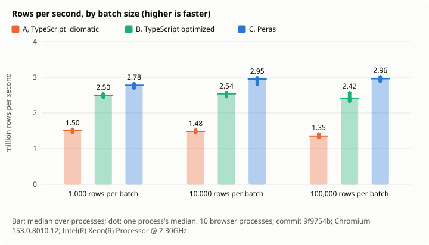
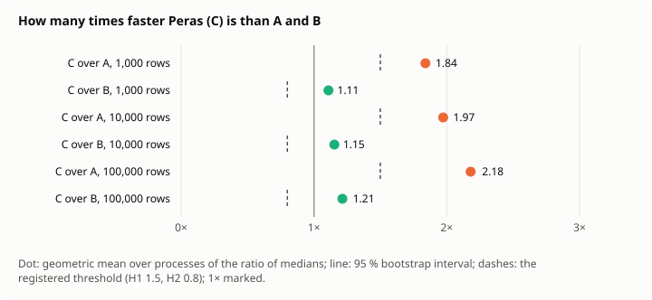
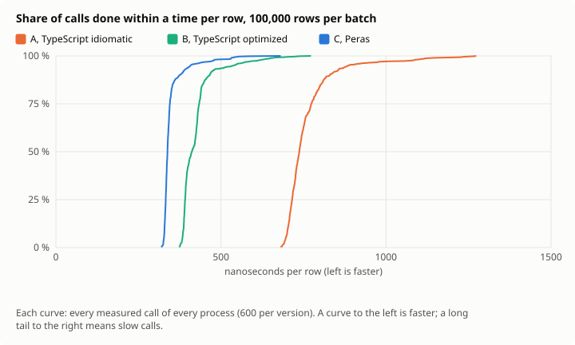
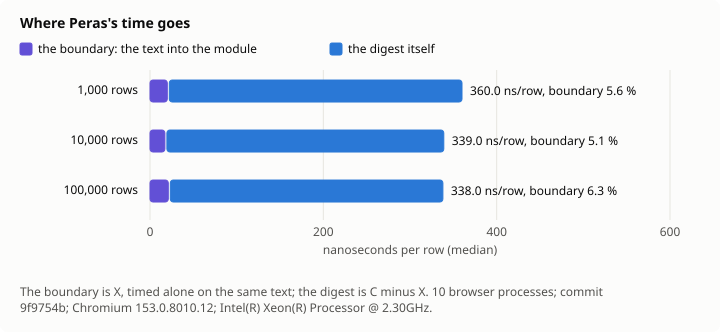

# Decision 0015: results

Measured at commit `9f9754b`, 2026-11-11, under [the protocol](../../../docs/en/decisions/0015-stream-measured.md). Every number below is in [results.json](results.json), with every call's time.

- Machine: Intel(R) Xeon(R) Processor @ 2.30GHz, 4 cores, linux 6.18.44-fc-v378; Chromium 153.0.8010.12; Node v24.22.1.
- Design: 10 browser processes; batches of 1000, 10000, 100000 rows; the calls in a Latin square of 4 orders; 95 % intervals by a hierarchical bootstrap of 10000 resamples, seed 15.
- Clock: cross-origin isolated true, its step at most 5.0 µs.
- Agreement: every batch of every pool gave the same digest in A, B and C, and C refused exactly the lines broken on purpose.

## Hypotheses

| | Registered | Measured, 95 % interval | Verdict |
| --- | --- | --- | --- |
| H1 | C at least 1.5 times as fast as A, at 10,000 and 100,000 rows | 1.97 [1.95, 1.99]; 2.18 [2.15, 2.21] | holds |
| H2 | C at least 0.8 times as fast as B, at 10,000 and 100,000 rows | 1.15 [1.14, 1.17]; 1.21 [1.19, 1.24] | holds |
| H3 | C's rows per second at 1,000 rows at least 0.75 times those at 100,000 | 0.94 [0.91, 0.96] | holds |
| H4 | The boundary at most 15 % of C's time at 100,000 rows | 0.06 [0.06, 0.06] | holds |
| H5 | C's 99th percentile at most 1.5 times its median at 100,000 rows | 1.57 [1.40, 1.66] | undetermined |

## Time per batch

The median over processes of each process's median, in ms; rows per second from it; the spread of the process medians; the percentiles of all calls pooled.

| Rows | Version | Median ms | Min–max ms | CV | p95 ms | p99 ms | Rows/s | ns/row |
| ---: | --- | ---: | ---: | ---: | ---: | ---: | ---: | ---: |
| 1,000 | A, TypeScript idiomatic | 0.66 | 0.65–0.68 | 1.7 % | 0.92 | 1.19 | 1,503,759 | 665.0 |
| 1,000 | B, TypeScript optimized | 0.40 | 0.40–0.41 | 1.1 % | 0.55 | 0.67 | 2,500,000 | 400.0 |
| 1,000 | C, Peras | 0.36 | 0.35–0.37 | 1.8 % | 0.48 | 0.63 | 2,777,778 | 360.0 |
| 1,000 | X, the boundary alone | 0.02 | 0.02–0.02 | 0.0 % | 0.04 | 0.05 | 50,000,000 | 20.0 |
| 10,000 | A, TypeScript idiomatic | 6.74 | 6.58–6.91 | 1.6 % | 10.13 | 11.92 | 1,482,580 | 674.5 |
| 10,000 | B, TypeScript optimized | 3.94 | 3.89–4.07 | 1.3 % | 5.97 | 6.83 | 2,537,266 | 394.1 |
| 10,000 | C, Peras | 3.39 | 3.35–3.56 | 2.3 % | 5.28 | 5.79 | 2,949,853 | 339.0 |
| 10,000 | X, the boundary alone | 0.17 | 0.17–0.23 | 11.3 % | 0.33 | 0.39 | 57,971,015 | 17.2 |
| 100,000 | A, TypeScript idiomatic | 73.90 | 71.05–76.20 | 2.6 % | 88.79 | 114.96 | 1,353,203 | 739.0 |
| 100,000 | B, TypeScript optimized | 41.39 | 39.01–42.94 | 3.6 % | 53.93 | 66.04 | 2,416,334 | 413.9 |
| 100,000 | C, Peras | 33.80 | 33.21–34.56 | 1.6 % | 40.76 | 53.19 | 2,958,689 | 338.0 |
| 100,000 | X, the boundary alone | 2.11 | 2.09–2.18 | 1.3 % | 2.59 | 3.33 | 47,337,278 | 21.1 |

## Ratios

| Rows | C over A | C over B | B over A | C's boundary share | C's p99 / p50 |
| ---: | ---: | ---: | ---: | ---: | ---: |
| 1,000 | 1.84 [1.81, 1.86] | 1.11 [1.10, 1.12] | 1.66 [1.64, 1.67] | 0.06 [0.05, 0.06] | 1.74 [1.58, 1.79] |
| 10,000 | 1.97 [1.95, 1.99] | 1.15 [1.14, 1.17] | 1.71 [1.69, 1.73] | 0.05 [0.05, 0.06] | 1.69 [1.63, 1.80] |
| 100,000 | 2.18 [2.15, 2.21] | 1.21 [1.19, 1.24] | 1.79 [1.76, 1.83] | 0.06 [0.06, 0.06] | 1.57 [1.40, 1.66] |

## Figures

