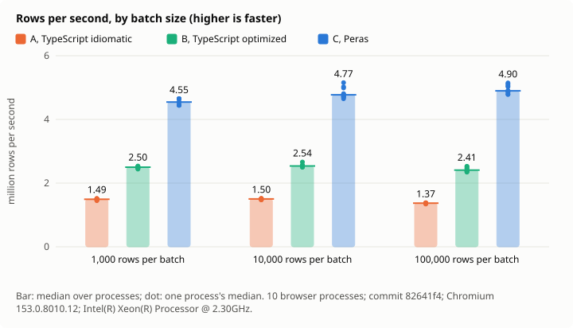
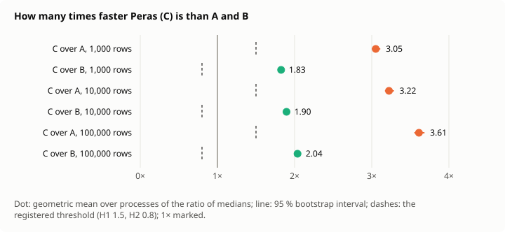
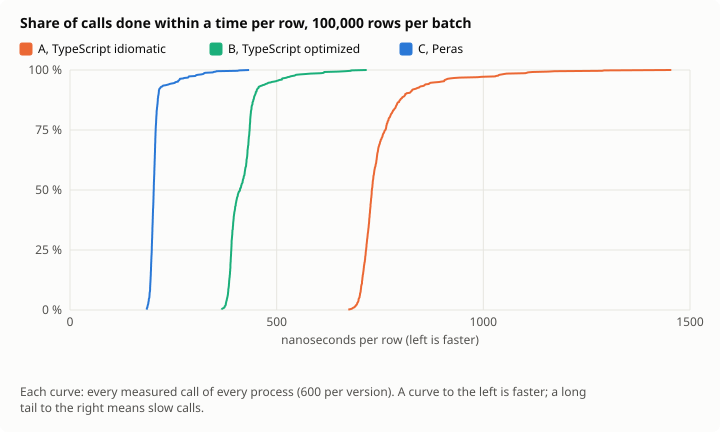
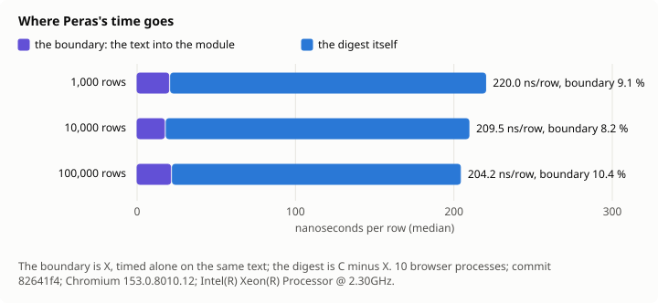

# Decision 0015: results

Measured at commit `82641f4`, 2026-11-12, under [the protocol](../../../docs/en/decisions/0015-stream-measured.md). Every number below is in [results.json](results.json), with every call's time.

- Machine: Intel(R) Xeon(R) Processor @ 2.30GHz, 4 cores, linux 6.18.44-fc-v378; Chromium 153.0.8010.12; Node v24.22.1.
- Design: 10 browser processes; batches of 1000, 10000, 100000 rows; the calls in a Latin square of 4 orders; 95 % intervals by a hierarchical bootstrap of 10000 resamples, seed 15.
- Clock: cross-origin isolated true, its step at most 5.0 µs.
- Agreement: every batch of every pool gave the same digest in A, B and C, and C refused exactly the lines broken on purpose.

## Hypotheses

| | Registered | Measured, 95 % interval | Verdict |
| --- | --- | --- | --- |
| H1 | C at least 1.5 times as fast as A, at 10,000 and 100,000 rows | 3.22 [3.17, 3.29]; 3.61 [3.55, 3.68] | holds |
| H2 | C at least 0.8 times as fast as B, at 10,000 and 100,000 rows | 1.90 [1.87, 1.92]; 2.04 [1.99, 2.07] | holds |
| H3 | C's rows per second at 1,000 rows at least 0.75 times those at 100,000 | 0.93 [0.88, 0.95] | holds |
| H4 | The boundary at most 15 % of C's time at 100,000 rows | 0.11 [0.10, 0.11] | holds |
| H5 | C's 99th percentile at most 1.5 times its median at 100,000 rows | 1.71 [1.42, 2.02] | undetermined |

## Time per batch

The median over processes of each process's median, in ms; rows per second from it; the spread of the process medians; the percentiles of all calls pooled.

| Rows | Version | Median ms | Min–max ms | CV | p95 ms | p99 ms | Rows/s | ns/row |
| ---: | --- | ---: | ---: | ---: | ---: | ---: | ---: | ---: |
| 1,000 | A, TypeScript idiomatic | 0.67 | 0.66–0.69 | 1.5 % | 1.06 | 1.26 | 1,492,537 | 670.0 |
| 1,000 | B, TypeScript optimized | 0.40 | 0.39–0.41 | 1.2 % | 0.62 | 0.74 | 2,500,000 | 400.0 |
| 1,000 | C, Peras | 0.22 | 0.22–0.23 | 2.1 % | 0.37 | 0.45 | 4,545,455 | 220.0 |
| 1,000 | X, the boundary alone | 0.02 | 0.02–0.02 | 0.0 % | 0.04 | 0.05 | 50,000,000 | 20.0 |
| 10,000 | A, TypeScript idiomatic | 6.66 | 6.57–6.77 | 1.1 % | 7.50 | 10.63 | 1,502,630 | 665.5 |
| 10,000 | B, TypeScript optimized | 3.94 | 3.76–4.00 | 1.8 % | 4.30 | 6.18 | 2,538,071 | 394.0 |
| 10,000 | C, Peras | 2.09 | 1.94–2.15 | 3.4 % | 2.34 | 3.42 | 4,773,270 | 209.5 |
| 10,000 | X, the boundary alone | 0.17 | 0.16–0.18 | 4.0 % | 0.29 | 0.34 | 57,971,014 | 17.3 |
| 100,000 | A, TypeScript idiomatic | 72.93 | 72.39–74.43 | 0.8 % | 89.33 | 110.80 | 1,371,084 | 729.3 |
| 100,000 | B, TypeScript optimized | 41.52 | 39.57–42.65 | 2.7 % | 48.78 | 61.45 | 2,408,695 | 415.2 |
| 100,000 | C, Peras | 20.42 | 19.44–20.91 | 2.6 % | 25.68 | 34.60 | 4,898,359 | 204.2 |
| 100,000 | X, the boundary alone | 2.12 | 2.05–2.22 | 2.4 % | 2.50 | 3.33 | 47,169,811 | 21.2 |

## Ratios

| Rows | C over A | C over B | B over A | C's boundary share | C's p99 / p50 |
| ---: | ---: | ---: | ---: | ---: | ---: |
| 1,000 | 3.05 [3.00, 3.11] | 1.83 [1.79, 1.85] | 1.67 [1.66, 1.69] | 0.09 [0.09, 0.09] | 2.02 [1.91, 2.09] |
| 10,000 | 3.22 [3.17, 3.29] | 1.90 [1.87, 1.92] | 1.70 [1.69, 1.72] | 0.08 [0.08, 0.08] | 1.64 [1.45, 1.72] |
| 100,000 | 3.61 [3.55, 3.68] | 2.04 [1.99, 2.07] | 1.77 [1.74, 1.81] | 0.11 [0.10, 0.11] | 1.71 [1.42, 2.02] |

## Figures

