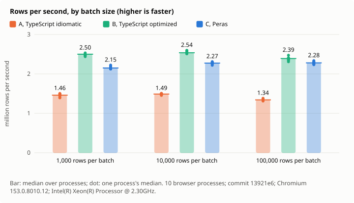
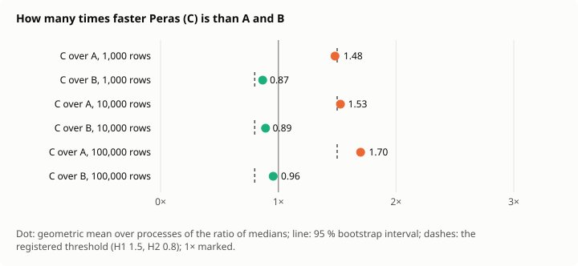
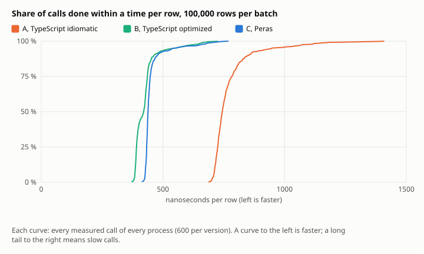
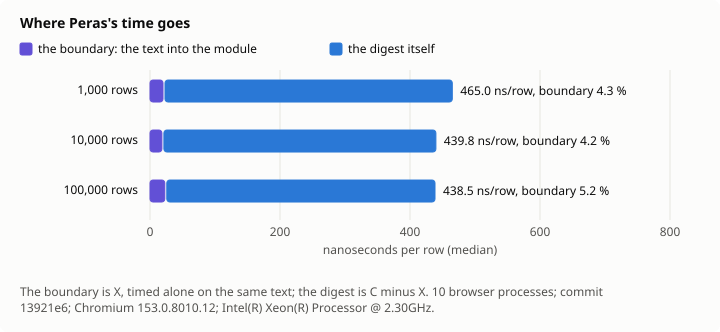

# 0015: The stream of sensors, measured

_French translation: [../../fr/decisions/0015-stream-measured.md](../../fr/decisions/0015-stream-measured.md)._

_Status: protocol registered on 2026-11-11 (commit `13921e6`), before any measure. Run 1 at the same commit: four hypotheses hold, one is undetermined; Peras is 1.5 to 1.7 times as fast as TypeScript as written, and 0.87 to 0.96 times as fast as TypeScript written for speed. The results will be added below it, whether they confirm the hypotheses or not; the protocol will not change after the first measure, and any departure from it will be listed as such._

## Context

The [stream app](../stream.md) shows, live, how fast Peras digests a stream of sensor readings beside the same digest in TypeScript. What it shows is fit for watching, not for a claim: one machine, one moment, a single run, a mean of whatever happened, and only the TypeScript written plainly. This study measures the same work as an engineer would before deciding on it: independent repetitions, a competitor written for speed, distributions rather than averages, intervals rather than single numbers, and thresholds fixed before the first measure.

It asks four questions:

1. How many rows per second does Peras digest, against TypeScript written plainly and TypeScript written for speed?
2. Does the speed hold for small batches, where each call into WebAssembly costs its fixed price?
3. How much of Peras's time is the boundary, the text copied into the module's memory, rather than the digest?
4. Is its time steady from one call to the next, or are there slow calls?

## The work

The digest of the [stream app](../stream.md), unchanged: one batch of lines `ts,sensor,zone,temp,humidity,watts` as CSV text, generated from a seed (`examples/stream/src/generate.ts`); about one line in 400 broken on purpose, of five kinds. For each batch: the lines read, refused and kept; for each zone, the readings, alerts, sums, minimum and maximum of temperature, humidity and energy; a histogram of temperatures; the hottest reading. Its canonical text (`canonical` in `examples/stream/src/digest.ts`) must be the same in every version, and the lines refused must be exactly those the generator broke.

## The versions

- **A. TypeScript, idiomatic**: `examples/stream/src/digest.ts`, the app's own: `split`, regular expressions, `Number`, `BigInt` for the range of an integer, a `Map` of objects.
- **B. TypeScript, optimized by hand**: `bench/stream/digest-optimized.ts`. The text is walked once by character codes, without `split`, regular expression or array per line; a number's text is checked by hand and read by `Number` only once known to be one.
- **C. Peras**: `examples/stream/src/telemetry.peras`, the app's module, built with `perasc build --allocator tlsf`, the production build.
- **X. The boundary alone**: `bench/stream/boundary.peras`, a function that takes the text and returns its length, built the same way. Its time is the cost of passing the text into a Peras module, measured alone, to split C's time into the boundary and the digest.

A, B and C give the same digest; this is checked on every batch of every pool before any time is taken.

## Design

- **Sizes**: batches of 1,000, 10,000 and 100,000 rows, about 38 KB, 380 KB and 3.8 MB of text.
- **Pool**: 64, 32 and 12 distinct batches per size, read in turn, so that no version always sees the same text.
- **Processes**: 10 independent browser processes, each a new Chromium launched by Playwright, one after the other. A process is the unit of replication: what a process shares (its JIT, its heap, its machine state) is not counted as independent.
- **Rounds**: in each process and at each size, 200, 40 and 10 rounds of warm-up, discarded, then 800, 200 and 60 rounds measured. In a round, A, B, C and X each digest the same batch, in an order that rotates through a Latin square of four orders, so that each version comes first, second, third and fourth equally often.
- **Clock**: `performance.now()` in a page served with `Cross-Origin-Opener-Policy: same-origin` and `Cross-Origin-Embedder-Policy: require-corp`, cross-origin isolated, whose clock steps by 5 µs instead of 100; the step is measured and recorded. The page runs the versions on its main thread; nothing else runs in it.
- **Not controlled**: the garbage collector, which runs when it runs, inside the calls it falls in; the JIT's tiers after warm-up; the machine's other load.

## Measures

- **Time per batch**: each call's duration in milliseconds. Per version, size and process, its median; per version and size, the median of the 10 process medians, and their range and coefficient of variation.
- **Rows per second**: the batch size over the median time.
- **Percentiles**: the 50th, 95th and 99th of all calls of all processes pooled.
- **Speed ratio**: how many times faster C is than A (or B): per process, A's median over C's; over processes, their geometric mean.
- **Boundary share**: per process, X's median over C's; over processes, their mean.
- **Small over large**: C's rows per second at 1,000 rows over its rows per second at 100,000 rows.
- **Tail**: C's 99th percentile over its median, at 100,000 rows, all calls pooled.

**Intervals**: 95 %, by a hierarchical bootstrap: 10,000 resamples, seed 15; in each, the processes are drawn with replacement, then each drawn process's calls; the statistic is computed on the resample; the interval is from the 2.5th to the 97.5th percentile of the 10,000 values. For small over large, the processes of each size are drawn independently.

## Hypotheses

Each with its threshold. **Decision rule**: a hypothesis _holds_ when its whole 95 % interval is on the right side of its threshold; it is _refuted_ when its whole interval is on the wrong side; otherwise it is _undetermined_, and reported as such, never as holding. If any version gives a different digest on any batch, every hypothesis is undetermined.

- **H1, Peras beats TypeScript as written.** C is at least 1.5 times as fast as A, at 10,000 and at 100,000 rows. Both must hold.
- **H2, Peras comes close to TypeScript written for speed.** C is at least 0.8 times as fast as B, at 10,000 and at 100,000 rows. Both must hold.
- **H3, small batches cost little more.** C's rows per second at 1,000 rows are at least 0.75 times its rows per second at 100,000 rows.
- **H4, the boundary is cheap.** X is at most 15 % of C's time at 100,000 rows.
- **H5, steady.** C's 99th percentile is at most 1.5 times its median, at 100,000 rows.

The thresholds were written in the script before it was first run. A smoke run with 2 processes and few rounds was then made to test the script and the definitions, as decision 0014 taught (finding M003); its numbers were seen. They are not results, they are not kept, and the thresholds were not changed after them: that is a threat to validity, listed below.

## Figures

Written by the script from `results.json`, never drawn by hand; each says what it shows under it, with the number of processes, the commit and the machine.

- **Rows per second, by batch size.** A bar per version and size at the median over processes; a dot for each process's median, so that the spread is seen. Higher is faster.
- **How many times faster C is.** For C over A and C over B at each size: a dot at the ratio, a line across its 95 % interval, dashes at the registered threshold, and a line at 1×, where the two are as fast. An interval wholly right of its dashes is a hypothesis that holds.
- **The distribution of the time per row**, at 100,000 rows: for each version, the share of calls (vertical) done within a time per row (horizontal). A curve further left is faster; a steep curve is steady; a long flat run to the right is a tail of slow calls.
- **Where Peras's time goes.** C's median time per row at each size, split into X, the boundary, and the rest, the digest.

## Threats to validity

- **One machine**, a shared cloud container with 4 cores; its neighbours' load is not controlled. The 10 processes and the intervals measure the variation it causes; they do not make the numbers another machine's.
- **One engine**: Chromium's V8. The WebKit and Gecko engines are not measured here.
- **The authors wrote every version**, B included. Another engineer might write a faster B, or a faster C.
- **Synthetic data**, generated; real readings may be shorter, longer, or broken in other ways.
- **The main thread**: the app runs its digest in a worker. The study runs on the page's main thread, the same engine and compiler, without the worker's messages, which the app's figures include.
- **The smoke run's numbers were seen** before this registration.
- **The garbage collector** falls in some calls and not others; the percentiles include it, as a user would see it.

## Reproduce

```sh
cargo build --release -p perasc
node scripts/bench-stream.mjs --check   # the versions agree, in Node
node scripts/bench-stream.mjs           # the measure: about 5 minutes
```

The script writes `bench/stream/RESULTS.md`, `bench/stream/results.json`, with every call's time, and the four figures in `docs/assets/stream-*.svg`.

## Run 1: results

Measured at commit `13921e6`, the protocol's own, with nothing else running; the [report](../../../bench/stream/run-1/RESULTS.md) and every call's time in [results.json](../../../bench/stream/run-1/results.json). Every batch of every pool gave the same digest in A, B and C, and C refused exactly the lines broken on purpose.

| Hypothesis                                           | Measured, 95 % interval                                        | Verdict      |
| ---------------------------------------------------- | -------------------------------------------------------------- | ------------ |
| H1, C at least 1.5 times as fast as A                | 1.53 [1.52, 1.54] at 10,000 rows; 1.70 [1.68, 1.71] at 100,000 | holds        |
| H2, C at least 0.8 times as fast as B                | 0.89 [0.88, 0.90] at 10,000 rows; 0.96 [0.93, 0.97] at 100,000 | holds        |
| H3, small batches cost little more                   | 0.94 [0.93, 0.96]                                              | holds        |
| H4, the boundary at most 15 %                        | 5 % [5 %, 5 %]                                                 | holds        |
| H5, C's 99th percentile at most 1.5 times its median | 1.61 [1.48, 1.70]                                              | undetermined |

**What it says.** Peras digests the stream 1.5 to 1.7 times as fast as the TypeScript as written, and the boundary costs it 5 %. It does not beat TypeScript written for speed: it runs at 0.87 to 0.96 times its speed, 4 to 13 % slower. H2 holds because its threshold was 0.8, not because Peras wins: between the two TypeScripts, Peras sits closer to the fast one, and below it. Its slow calls are not settled: the interval of its tail crosses its threshold.









Why Peras is not faster is the next question; it is profiled in [the findings](../findings.md), one step removed at a time.
