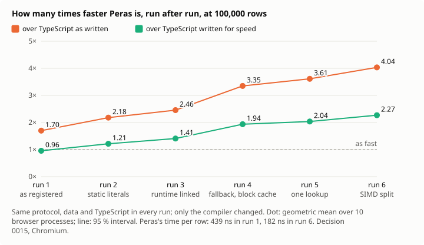

# 0016: Making the compiler faster, from what was measured and what is published

_French translation: [../../fr/decisions/0016-faster-from-the-literature.md](../../fr/decisions/0016-faster-from-the-literature.md)._

_Status: proposed on 2026-11-11, closed on 2026-11-12 (see [Outcome](#outcome)). Each change is measured when it lands, by a new run of [decision 0015](0015-stream-measured.md)'s protocol, unchanged; a change that does not show its gain there is reported as such._

## Context

Decision 0015 measured the stream app's digest under a registered protocol: Peras is 1.5 to 1.7 times as fast as TypeScript as written, but 0.87 to 0.96 times as fast as TypeScript written for speed. A profile by removal (`node scripts/profile-stream.mjs`) then found where the time goes, per 1,000,000 rows, of about 363 ms:

| Step                                                          | Cost                      | Finding                |
| ------------------------------------------------------------- | ------------------------- | ---------------------- |
| Checking a zone's letters with `for (const c of s.split(""))` | 90 to 98 ms               | [F207](../findings.md) |
| Splitting each line into an array of fields                   | 40 to 58 ms               | [F208](../findings.md) |
| Returning `Option<Reading>`, and `unwrapOr`'s fallback        | 35 to 55 ms               | [F209](../findings.md) |
| `has` then `get` on a map keyed by strings                    | 41 to 44 ms               | [F210](../findings.md) |
| Walking the lines                                             | about 33 ms               |                        |
| Reading the numbers                                           | about 30 ms in all, noisy |                        |

None of these is a cost of WebAssembly: the boundary is 5 % (0015, H4). Each is work the compiler makes the program do that the program did not ask for: an array it never keeps, a block for a value that lives a moment, a hash computed twice. Compilers have known how to remove each of them for decades. This decision lists, for each, the published technique, how it would apply to Peras, and what it should save.

## The techniques

**1. Fuse the walk over characters with its consumer** (F207). Coutts, Leshchinskiy and Stewart, _Stream Fusion: From Lists to Streams to Nothing at All_, ICFP 2007, remove the intermediate list between a producer and its consumer by turning both into a stream and fusing them. Peras already does this for `for (const part of text.split(sep))` with a literal separator (F206), not for the empty one. The change: the same streaming for `split("")`, one character at a time in one view, and `charCodeAt(i)` so that a class of characters is checked on an integer, with no string at all. **Expected**: most of the 90 ms; the check becomes a loop over bytes.

**2. Find the redundant lookup and do it once** (F210). Morel and Renvoise, _Global Optimization by Suppression of Partial Redundancies_, Communications of the ACM 22(2), 1979, remove a computation done twice on a path. Here the computation is the lookup of one key: `m.has(k)` then `m.get(k)`, or `m.get(k)` then `m.set(k, …)`, with no change to `m` or `k` between. The change: the IR recognizes the pair and keeps the slot found by the first. SipHash stays (Aumasson and Bernstein, INDOCRYPT 2012): it protects against keys chosen to collide, and the change halves how often it runs. **Expected**: about half of the 41 to 44 ms.

**3. Do not allocate what does not escape** (F208). Choi, Gupta, Serrano, Sreedhar and Midkiff, _Escape Analysis for Java_, OOPSLA 1999, find the objects that do not outlive the method that makes them and allocate them on its stack. Tofte and Talpin, _Region-Based Memory Management_, Information and Computation 132(2), 1997, infer where memory can be freed all at once. Reinking, Xie, de Moura and Leijen, _Perceus: Garbage Free Reference Counting with Reuse_, PLDI 2021, reuse a block freed just before an allocation of the same size. The change: an array of views made in a loop's body and not leaving it reuses one block from one iteration to the next. **Expected**: most of the 40 to 58 ms.

**4. Return small values in values** (F209). The same escape analysis applies to a function's result: an `Option` of a structure that the caller unwraps at once need not be a block of the heap; WebAssembly's multiple results can carry it. And `unwrapOr(fallback)` evaluates its fallback only when the value is missing, as `??` does in JavaScript, which F104 asks for. **Expected**: most of the 35 to 55 ms.

**5. Scan many bytes at once** (lines, fields, numbers). Langdale and Lemire, _Parsing Gigabytes of JSON per Second_, The VLDB Journal 28(6), 2019, find the structural characters of a text with SIMD instructions, many bytes per instruction. WebAssembly has 128-bit SIMD, which Peras already uses in loops. The change: `split` and the streamed walk look for their separator 16 bytes at a time. Lemire, _Number Parsing at a Gigabyte per Second_, Software: Practice and Experience 51(8), 2021, parses decimals exactly without the slow path in most cases; Peras's `parseF64` uses Clinger's fast path (_How to Read Floating Point Numbers Accurately_, PLDI 1990) and asks the host beyond it. **Expected**: a part of the 33 ms of lines and of the numbers; smaller, and later.

## Order

By gain over cost, each measured before the next:

1. Streamed characters and `charCodeAt` (technique 1).
2. One lookup for `has` or `get` then `get` or `set` of one key (technique 2).
3. Reuse of a loop body's array of views (technique 3).
4. `Option` of a structure returned in values, and a lazy `unwrapOr` (technique 4).
5. SIMD search for separators (technique 5).

If 1 to 4 each give most of what the profile shows, the digest goes from about 363 to about 200 ms per 1,000,000 rows: faster than the TypeScript written for speed (B, about 418 ms at 100,000 rows in 0015). That is a hope, not a result: a profile by removal gives the most a change can save, and the TypeScript engines improve too. Each run of 0015 says how much of it holds.

## What does not change

- The protocol of 0015, its versions A and B, and its thresholds. The app's Peras program is not rewritten by hand to win: the gain must come from the compiler, for every program that is written plainly.
- Safety: every change keeps the debug allocator's checks, the release verifier and the tests of both modes. A block reused is still a block the verifier can account for.

## Measured after step 1

Step 1, the characters of `split("")` streamed, landed: correct and tested, it saved no time (finding M013). Its profile was redone, one thing removed at a time, and two costs it had hidden were measured:

- **Allocations** (F211). The digest allocates 7 blocks of the heap per row and releases 7: a string literal copied at each use, the view of a `split`, a cursor, two copies. An allocation and its release cost about 13 ns: about 90 ns per row, a quarter of the time.
- **Calls into the runtime** (F212). The runtime is its own instance; a call through an import costs 2.06 ns in Chromium, against 0.73 for a call inside the module, which the engine inlines (`node scripts/call-cost.mjs`). The digest makes 30 such calls per row: about 40 ns, 11 % of the time.

So the order changes. First, **literals as static blocks** (F211): lent without a copy, never released; small, and it removes three of the seven allocations of each row. Then **the runtime linked into the module** (F212): it removes the extra cost of every call, about 11 %, and lets the engine inline the small functions of the runtime, which may give more; that part is not measured yet. Then the steps above, which each remove an allocation.

## Outcome

Closed on 2026-11-12, after six runs of decision 0015, all under its registered protocol, with the same data, the same TypeScript and the same thresholds. Only the compiler and its runtime changed. Peras's digest, at 100,000 rows in Chromium:

| Run | Commit    | What landed before it                                                                          | Peras, ns per row | Peras over B, 95 % interval |
| --- | --------- | ---------------------------------------------------------------------------------------------- | ----------------- | --------------------------- |
| 1   | `13921e6` | nothing: the compiler as 0015 registered it                                                    | 438.5             | 0.96 [0.93, 0.97]           |
| 2   | `9f9754b` | string literals as static blocks (F211)                                                        | 338.0             | 1.21 [1.19, 1.24]           |
| 3   | `7470d08` | the runtime linked into the module (F212)                                                      | 304.7             | 1.41 [1.37, 1.44]           |
| 4   | `99f9202` | a quiet `unwrapOr` fallback made only when needed (F209), a cache of small freed blocks (F211) | 218.2             | 1.94 [1.87, 2.00]           |
| 5   | `82641f4` | one map lookup instead of two (F210)                                                           | 204.2             | 2.04 [1.99, 2.07]           |
| 6   | `9dc9566` | the separator searched 16 bytes at a time, one block per split, a character step (F207, F208)  | 182.1             | 2.27 [2.23, 2.31]           |

TypeScript written for speed (B) stayed between 413.9 and 427.1 ns per row over the six runs, and TypeScript as written (A) between 729.3 and 745.9. Peras's time per row fell 2.4 times. It went from 0.96 times as fast as B to 2.27 times, and from 1.70 times as fast as A to 4.04 times. The hope written above was about 200 ms per 1,000,000 rows. Run 6 gives 182 ns per row, 182 ms per 1,000,000, and the profile in Node gives about 181 ms.

**What did not give what was expected**

- Step 1, the characters streamed, saved nothing on its own (M013). The profile had put the cost on the array when the cost was in the calls and allocations. Removing those, in runs 2 to 4, gave most of the gain.
- Two first tries at the lookup gave nothing and were taken back (F210):
  - a hash remembered;
  - keys compared 8 bytes at a time.
- H5, the slow calls, stays refuted: 1.74 [1.66, 1.81] in run 6. The slowest calls fall less than the median. None of these techniques was aimed at them.

**What was not done, and why**

- Technique 3 in full, an escape analysis: not done. Two smaller steps took most of its gain:
  - a split makes one block instead of one per field;
  - a freed block of the same size is reused through the cache.
- `Option` returned in WebAssembly values (technique 4): not done. The lazy fallback took most of what F209 measured.
- Lemire's number parsing: not done. The numbers are a small part of the time. `parseF64` reads decimals exactly today, and changing it is a risk to its correctness for a small gain.

**Safety**

Every step kept the debug allocator's checks, the release verifier and the end-to-end tests of both allocators. From the lookup pass on, every optimization also passed:

- the differential test (M015): random programs run five ways, which must agree and leave no block alive;
- 2,000 of these programs once;
- a run with the optimization broken on purpose, which the test caught.

A program written plainly gets these gains with nothing to change. The stream app's Peras source was not rewritten to win.
