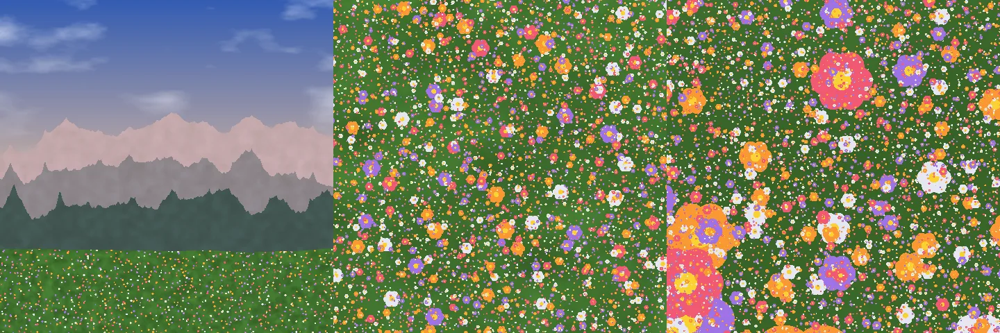

# The garden of Apeiron

_French translation: [../fr/garden.md](../fr/garden.md)._

_Peras_, in Greek, is the limit; _apeiron_, the unlimited. For the Pythagoreans, every good thing arises from limit imposed on the unlimited. The garden of Apeiron is that idea as a program: a landscape without end, a sky, mountains and a meadow, born of a few finite rules, which gains detail however far it is zoomed.

It is also a measure. The shortest program that draws an image is the image's best compression; a scene computed pixel by pixel stretches like a vector image, and, unlike one, adds detail as it is zoomed. How much smaller, how much sharper, how fast, at what cost: [decision 0013](decisions/0013-garden-of-apeiron.md) asked it under a protocol registered before any measure, and reports what it found, the refuted hypothesis included.

## Before, after


The same corner of the garden, zoomed 8 then 64 times. Left, the stored image: the smallest AVIF of the whole scene that looks right at full size, 9.5 KB, enlarged as a viewer enlarges it; at ×64, 16 of its pixels fill the frame. Right, the program, 5.7 KB, drawing the window at that zoom. Their likeness, by SSIM, is 0.22 at ×8 and 0.20 at ×64. Even the lossless PNG, 471 KB, has 16 pixels across at ×64: no stored image can draw the flowers it does not hold.

## Zoom into it yourself

The [playground](https://artkabis.github.io/Peras/playground/) shows the same window twice, the stored AVIF enlarged on the left and the program drawing it on the right; drag to move, scroll or pinch to zoom, down to 65,536 times. The program is the one the benchmark measured, `bench/garden/garden.peras`, run in a Web Worker, and a test in Chromium checks that its canvas holds the reference's pixels, byte for byte. Its figures are read from the results, and the URL keeps the place, to share it. To run it from the repository: `cargo build --release -p perasc`, then `pnpm --filter peras-example-garden dev` ([source](../../examples/garden)).

## Three zooms



Each doubling of the zoom adds an octave to every noise and a smaller kind of flower. The cost of a pixel grows with the logarithm of the zoom only.

## What was measured

Under the protocol, on one machine, in Chromium; the [results](../../bench/garden/RESULTS.md), and every number in [results.json](../../bench/garden/results.json).

| Hypothesis                                    | Verdict     | Measured                                                     |
| --------------------------------------------- | ----------- | ------------------------------------------------------------ |
| The same pixels in TypeScript, Peras and Rust | yes         | bit for bit, at zooms 1, 4, 16 and 64                        |
| H1, the program is smaller than its image     | holds       | 5,872 bytes against 9,774 for the smallest AVIF at SSIM 0.95 |
| H2, a stored image grows with the zoom        | holds       | at ×64, 4,452 times the bytes of ×1; 142 times at the least  |
| H3, Peras 1.3 times as fast as TypeScript     | **refuted** | 1.19 times TypeScript, 1.11 times Rust                       |
| H4, the eye forgives from afar                | holds       | every lossy format scores higher reduced 4 times             |
| H5, safety costs nothing at the frame         | holds       | overflow checks cost 2 % in debug                            |

## What it does not say

- **That Peras is the smallest.** The same program in TypeScript ships in 1,119 bytes, five times fewer: it is the procedural scene that beats its image, and Peras carries the weight of its WebAssembly runtime.
- **That Peras is much faster.** 1.19 times TypeScript on floating-point loops, short of the 1.3 times registered: the hypothesis is refuted, and said so.
- **That it holds for any image.** A landscape of noise suits the procedural; a photograph has no short program.
- **That SSIM is the eye.** It is one model of perception; closer ones, Butteraugli and SSIMULACRA2, are left to a later run.

## Run it again

```sh
cargo build --release -p perasc
node scripts/bench-garden.mjs          # the measures, under the protocol
node scripts/garden-showcase.mjs       # the before and after, its numbers computed
node scripts/bench-garden.mjs --check  # the same pixels everywhere, as CI checks
```

The three versions: [TypeScript](../../bench/garden/garden.ts), the reference; [Peras](../../bench/garden/garden.peras); [Rust](../../bench/garden/rust/src/lib.rs). Each uses only operations IEEE 754 defines exactly and an integer hash, so that the three draw the same garden.
