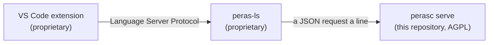

# Editors

_French translation: [../../fr/guide/editors.md](../../fr/guide/editors.md)._

Peras has a language server and a VS Code extension. Both are **proprietary**, kept in a private repository apart from this one, as [decision 0006](../decisions/0006-licensing.md) sets: their code is not published here. This page says what they do, how they reach Peras, and where they stand. They are not distributed yet.

## What the extension gives

In a `.peras` or `.apeiron` file:

| Feature                                                                      | State |
| ---------------------------------------------------------------------------- | ----- |
| errors as you type, with their codes, as `perasc check`                      | done  |
| hover: what a name is, and its type                                          | done  |
| go to definition, in the file or in a file it imports                        | done  |
| find every reference                                                         | done  |
| the outline of a file: functions, structures, enumerations, module variables | done  |
| completion: the fields and methods after a `.`, the names in scope           | done  |
| format the document, as `perasc fmt` ([formatting](formatting.md))           | done  |
| comments and brackets of both languages                                      | done  |
| renaming                                                                     | next  |

Two settings, `peras.serverPath` and `peras.perascPath`, name the language server and `perasc` when they are not on the `PATH`.

## How it reaches Peras

The tools use Peras only through what Peras publishes, never its code:

- **`perasc serve`**, in this repository ([decision 0042](../decisions/0042-queries.md), its protocol in [`perasc serve`](../reference/serve.md)), keeps each file opened with its analysis, and answers diagnostics, hover, definition, references, symbols, completion and formatting, in about a tenth of a millisecond. Any tool can use it.
- **`peras-ls`**, the language server, written in Rust with one dependency, translates the editor's Language Server Protocol to `perasc serve` and back, positions included (the editor counts UTF-16 units from 0, `perasc` characters from 1).
- **The extension** is a client of that protocol written on VS Code's own API, with no package at run time.

What a tool needs and Peras does not publish is added to Peras first, by a decision of its own, in the open.

## Where they stand, measured

Each was chosen by a decision of its own, its options built and measured, as in this repository. The figures, on the machine of those runs:

- **The fifty answers** of Peras's query benchmark (`bench/query`), asked through LSP and then through VS Code's own commands: all fifty right, checked by the private repository's CI against a pinned commit of Peras.
- **The first errors** appear about 0.2 s after a file is opened, the extension not yet started; a request on the largest Peras file of this repository answers in 0.2 to 0.4 ms.
- **What it weighs**: the language server's binary, about 0.76 MB, 2.6 MB of memory with six files open; the extension, a package of about 5 KB.

## Next

- Renaming, through `perasc serve`'s references.
- The memory leak analyzer, the other proprietary tool the [roadmap](../reference/roadmap.md) plans, built on the debug allocator's checks, which stay in the open core.
- Distribution of the extension, when the owner decides.
