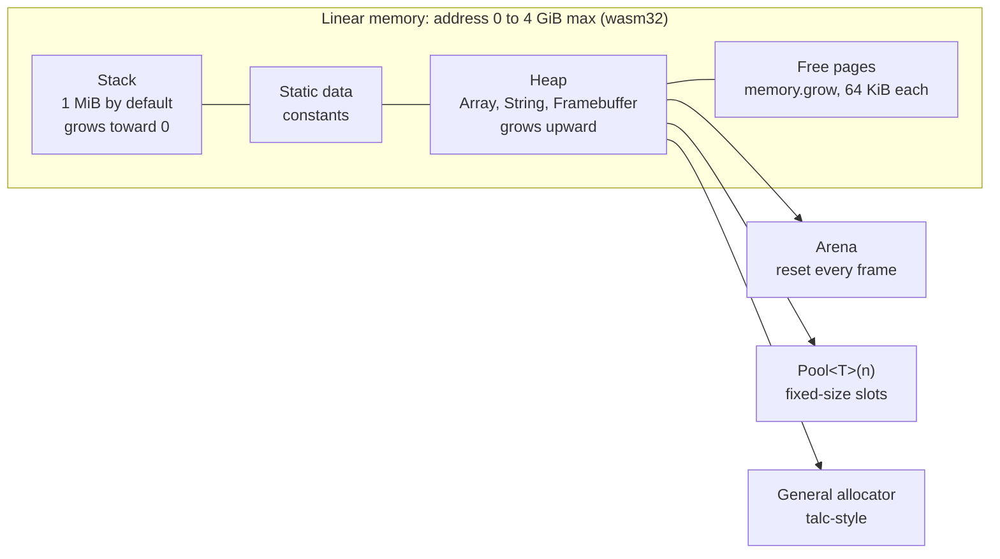
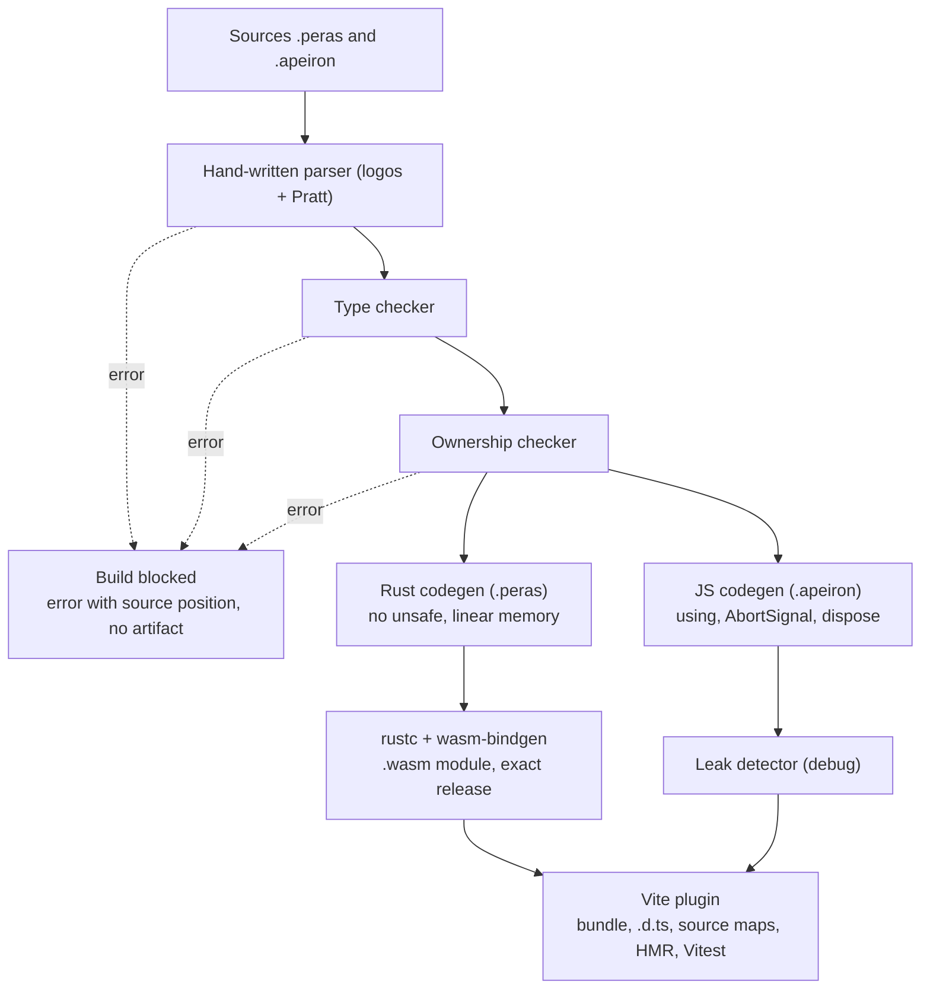

# Peras — Initial language spec

*Last updated: 2026-11-03. French translation: [../fr/spec.md](../fr/spec.md).*

## Vision and goals

Peras is a language with TypeScript syntax, compiled to WebAssembly for owned modules and to JavaScript for managed modules, with memory safety checked at compile time and no garbage collector in critical code.

Three pillars drive every design decision:

1. **Rasterization**: producing pixels is a native feature of the language, with typed framebuffers shared with the Canvas without copying.
2. **Memory management**: single ownership, deterministic release, no hidden allocation inside a render loop.
3. **Approachable syntax**: a TypeScript developer reads and writes Peras within a day, with no lifetime annotations.

These pillars rest on one cross-cutting rule: **compilation is uncompromising and talkative**. There are no warnings; every diagnostic blocks the build and explains the cause, the value's history and the fix.

Supporting principles:

- **Two modes**: `managed` for UI and the DOM, `owned` for computation and rendering. The compiler checks the boundary.
- **Integrated**: Vite plugin, Vitest tests, generated `.d.ts` types to use modules from JS.

Out of scope for the MVP: replacing JavaScript everywhere, multithreading, a native backend outside WASM.

## Name and extensions

The language is called **Peras**, and the file extension sets each module's mode: `.peras` for `owned`, `.apeiron` for `managed`.

- **Peras (πέρας), “the limit”**: for the Pythagoreans and in Plato's *Philebus*, everything good arises from limit imposed on the unlimited. The compiler imposes its limits on types, aliases and lifetimes. Rasterization imposes a finite pixel grid on continuous geometry.
- **Apeiron (ἄπειρον), “the unlimited”**: the open world of JS and the GC, which Peras disciplines without fully constraining.
- **The extension is the mode**: no `owned module` or `managed module` header. The Vite plugin routes each file to its backend, and the file tree shows at a glance which code lives under constraint.
- **Tools**: compiler `perasc`, plugin `vite-plugin-peras`, scaffolding `pnpm create peras`.
- **Checks**: no language, npm package or crate named Peras found, and no existing `.peras` or `.apeiron` file format. Still to do: trademark check (INPI, EUIPO) and reserving npm, crates.io, the GitHub organisation and the domain.

## TypeScript subset

Peras keeps TS syntax but removes everything that prevents complete static analysis.

| Feature | Status | Reason |
| --- | --- | --- |
| `let`, `const`, functions, arrows | Kept | Core of the language |
| `interface`, `type`, unions, generics | Kept | Core of the type system |
| `class` without inheritance | Kept | Inheritance replaced by composition and traits |
| `enum` and discriminated unions | Kept | With exhaustive `match` |
| `async` / `await` | Managed mode only | Relies on JS Promises |
| `any`, un-narrowed `unknown` | Removed | Bypasses typing |
| `eval`, `new Function`, `with` | Removed | Dynamic code cannot be analysed |
| Prototypes, dynamic `this` | Removed | Ownership cannot be determined |
| Implicit `null` / `undefined` | Removed | Replaced by `Option<T>` |
| `throw` exceptions | Removed in `owned` | Replaced by `Result<T, E>` |
| Generic `number` | Removed in `owned` | Explicit `i32`, `i64`, `f32`, `f64`, `u8` |

Additions: `match`, the `?` operator on `Result`, the `inout` and `sink` passing conventions. A module's mode is set by its extension, not by a keyword.

## Type system

Typing is static, strong and without escape hatches. Local inference avoids annotating every variable.

- **Structural in `managed`, nominal in `owned`**: a `UserId` and an `OrderId` that are both `i64` are not interchangeable in critical code.
- **Local inference** inside function bodies. Public signatures are always annotated.
- **Discriminated unions and narrowing** as in TS, with a `match` that must be exhaustive.
- **Monomorphized generics**: each instantiation produces specialized code, with no runtime cost.
- **Traits** instead of inheritance: `impl Display for User`.
- **No implicit conversion**: `i32 + f64` is an error; write `x.toF64() + y`.
- **Checked overflow** in debug, with explicit `wrappingAdd` and `checkedAdd` operations.

## Memory model

Peras uses mutable value semantics (inspired by Hylo) rather than Rust's references. This gives memory safety without lifetime annotations.

### Owned mode (`.peras`)

- Each value has a single owner. Assignment copies simple types and moves the others.
- No reference can be stored inside a data structure, so there is never a lifetime to write.
- Parameters use three passing conventions:
  - `let` (default): read-only, no copy.
  - `inout`: exclusive mutation. The compiler forbids any alias during the call.
  - `sink`: the function consumes the value. The caller can no longer use it.
- Deterministic release at end of scope, with no GC.
- Sharing only through an explicit `Rc<T>`, visible in the type.

### Managed mode (`.apeiron`)

Decision: managed mode compiles directly to JavaScript, not to WasmGC. WasmGC relies on the same GC as JS: it neither frees earlier nor prevents any leak. It does complicate interop and debugging, and would force a custom backend from the MVP onward. It remains a post-MVP option for a computation-heavy managed module.

In JS, a leak is not a missing free but a reference that stays attached. The compiler therefore applies ownership to **resources** and **long-lived references**:

- **RAII on resources**: listeners, timers, observers, `AbortController`, WebSockets and created DOM nodes are single-owner `Resource` values. The compiler inserts their release at end of scope through `using` and `Symbol.dispose`.
- **Listeners bound to an `AbortSignal`**: every generated `addEventListener` receives its owner's signal, and everything detaches with it.
- **Closure escape**: a closure registered on a long-lived target (`window`, `document`, a global store) cannot capture a short-lived value.
- **Bounded global collections**: a mutable global `Map` or `Array` is refused. Use a `WeakMap` or an `LruCache<K, V>(n)`.
- **DOM owned by components**: unmounting releases the subtree and its resources, with no orphaned detached nodes.
- **Leak detector in debug**: a `FinalizationRegistry` reports any `Resource` collected without being released. It shows as an error in the Vite overlay.
- **Native access**: DOM, `async`/`await` and `requestAnimationFrame` without glue, only in this mode.

Accepted limit: a plain object with no remaining reference waits for the GC. Anything that must be released immediately (pixels, audio buffers, large arrays) stays in `owned`.

### Boundary between modes

- An `owned` value passed to `managed` is copied or moved, never borrowed.
- A `managed` value enters `owned` through an explicit, validated conversion: `Point.from(obj)?`.
- An `owned` function cannot call a `managed` function. The reverse is allowed.

## Stack, heap and allocation

`.peras` modules live in WebAssembly linear memory: a single contiguous block of bytes, every use of which the compiler knows and bounds.



Memory grows in 64 KiB pages and never shrinks. The stack comes first, so an overflow leaves memory and stops execution instead of overwriting data.

### Where values live

- **Scalars** (`i32`, `f64`, `Rgba8`): WASM machine registers, with no memory address.
- **Fixed-size values that do not escape**: stack. With no stored references, escape analysis is simple and exact.
- **Variable-size values** (`Array`, `String`, `Framebuffer`): heap.
- **Visible memory layout**: every type has a fixed size and alignment, shown by `--verbose` and `sizeOf<T>()`.

### Compile-time guarantees

- **Proven stack depth**: `perasc` computes the maximum stack of each function and of the call graph. The build fails if it exceeds the budget.
- **Bounded recursion**: a recursive function must declare its maximum depth, otherwise it is an error.
- **`@frame` without allocation**: memory cannot grow during rendering.

### Budgets

Limits are declared in `peras.config.ts` and checked at compile time, then at runtime with a detailed error when exceeded.

| Budget | Example | Checked at |
| --- | --- | --- |
| Stack | 256 KiB | compile time |
| Initial memory | 32 MiB | compile time (framebuffers included) |
| Maximum heap | 64 MiB | runtime |
| Total ceiling | 512 MiB | runtime |

### Allocators

- **General allocator**, compact, `talc`-style, for the regular heap.
- **`Arena`**: allocation by bumping a pointer, reset in a single operation. Ideal for a frame's temporary data.
- **`Pool<T>(n)`**: `n` fixed-size slots with no fragmentation, for many identical objects.

### Memory growth and rendering

When memory grows, every JS view of that block becomes invalid, including the `ImageData` used by zero-copy `present`. Three rules prevent this:

1. Framebuffers are allocated at startup, with initial memory sized for them.
2. `@frame` forbids any allocation, hence any growth during rendering.
3. `present` recreates its view every frame, which costs almost nothing and stays safe after growth.

## Rasterization

Pixel rendering is part of the standard library and of the type system. Pixels live in `owned` WASM memory and the Canvas reads them without copying.

- **Explicit pixel types**: `Rgba8`, `RgbaF32`, `Gray8`. No implicit conversion between formats; `px.toRgba8()` is required.
- **Owned framebuffer**: `Framebuffer<Rgba8>` is a contiguous block in linear memory. `present(fb)` creates an `ImageData` view over that block and hands it to the Canvas, without copying.
- **Native primitives** in `std/raster`: lines, triangles via edge functions, fills, alpha blending and scaling, vectorized with 128-bit WASM SIMD.
- **Safe pixel access**: `fb.at(x, y)` returns an `Option`. The `fb.rows()` and `fb.pixels()` iterators remove bounds checks at compile time.
- **`@frame` rule**: a function annotated `@frame` may neither allocate nor call a function that allocates. The compiler proves it or refuses the build.
- **Render loop**: the `managed` side drives `requestAnimationFrame`, the `owned` side draws into a framebuffer passed as `inout`.
- **Later**: a WebGPU backend for shaders, with the same typed formats.

```typescript
// render.peras — owned mode
import { Framebuffer, Rgba8, triangle } from "std/raster";

@frame
export fn draw(fb: inout Framebuffer<Rgba8>, t: f32): void {
  fb.clear(Rgba8.black());
  const a = Point(160.0 + 80.0 * t.sin(), 40.0);
  triangle(&fb, a, Point(60.0, 200.0), Point(260.0, 200.0), Rgba8(255, 120, 0, 255));
}
```

## Strict compilation and diagnostics

Every anomaly is a blocking error, and every error must be enough to fix the code without opening the documentation.

### Rules refused at compile time

- Unused variable, import or parameter.
- Variable shadowing.
- Non-exhaustive `match`, ignored `Result`.
- Implicit return type on an exported function.
- Implicit numeric conversion, statically detectable overflow.
- Use after move, aliasing during an `inout`.
- Allocation inside an `@frame` function.
- DOM or JS access from a `.peras` module.

### Diagnostic format

Each error contains: a stable code, the exact position, the underlined source excerpt, the cause in one sentence, the value's history, a suggested fix as a diff, and the `perasc explain` command.

```text
error[E0204]: value used after move
  --> src/ui.apeiron:9:9
   |
 6 |   let buf = Buffer.from(data)?;
   |       --- `buf` is created here (type Buffer, owned)
 7 |   const n = consume(buf);
   |                     --- `buf` is moved here: `consume` takes it as `sink`
 9 |   gain(&buf, 0.8);
   |         ^^^ `buf` no longer exists on this line
   |
   = why: a `sink` parameter consumes the value; the caller loses access to it.
   = fix: read the length without consuming the buffer
   |
 7 - const n = consume(buf);
 7 + const n = buf.samples.length;
   |
   = details: perasc explain E0204
```

### Output modes

- **Default**: every error in the project in a single pass, sorted by file; the build fails.
- **`--verbose`**: adds the inferred type of each underlined expression, the full ownership trace and the matching generated Rust.
- **`--json`**: the same content, structured for the LSP, CI and the Vite overlay.
- **`--watch`**: incremental re-check on every save; only touched modules are re-analysed.
- **Language**: messages in English or French through `--lang`.

## Code examples

An owned audio-processing module, then its use from the managed UI.

```typescript
// dsp.peras — owned mode, set by the extension, no GC
export struct Buffer {
  samples: Array<f32>;
}

export fn gain(buf: inout Buffer, factor: f32): void {
  for (let i: i32 = 0; i < buf.samples.length; i++) {
    buf.samples[i] = buf.samples[i] * factor;
  }
}

export fn peak(buf: Buffer): Option<f32> {
  if (buf.samples.length == 0) return None;
  let max: f32 = 0.0;
  for (const s of buf.samples) { if (s.abs() > max) max = s.abs(); }
  return Some(max);
}

export fn consume(buf: sink Buffer): i32 {
  return buf.samples.length; // buf is released here
}
```

```typescript
// ui.apeiron — managed mode, set by the extension, with GC
import { Buffer, gain, peak } from "./dsp.peras";

export async fn onRecord(data: Float32Array): Promise<void> {
  let buf = Buffer.from(data)?;   // validated conversion
  gain(&buf, 0.8);                  // visible exclusive borrow
  match (peak(buf)) {
    Some(p) => document.querySelector("#peak")!.textContent = p.toString(),
    None => console.warn("empty buffer"),
  }
}
```

Expected blocking errors:

- Using `buf` after `consume(buf)` → *value moved*.
- Passing `buf` twice as `inout` in the same call → *aliasing forbidden*.
- Calling `document` in `dsp.peras` → *managed API outside managed mode*.

## Compiler architecture

`perasc` first checks typing and memory across the whole project, then generates Rust compiled to WASM for `.peras` modules, and disciplined JavaScript for `.apeiron` modules.

The parser is hand-written (`logos` lexer, recursive descent, Pratt parsing for expressions) to control error recovery and every message. Oxc is only used to generate JavaScript. Details in the [compiler kickoff plan](kickoff-plan.md).



The first three analyses stop the build with a message pointing at the source file. Rustc must never report an error on a program accepted by `perasc`.

## Tooling, tests and security

The `perasc` compiler is written in Rust and shipped as a binary and as an npm package.

- **Vite plugin** `vite-plugin-peras`: compiles `.peras` and `.apeiron` files on the fly, HMR on managed modules, an overlay listing every error in the detailed format, build refused while any error remains.
- **Tests**: a `test "name" { … }` block in `.peras` and `.apeiron` files, run by Vitest through an adapter. Compiler tests use snapshots (`insta`) of the AST, the errors and the generated Rust.
- **Fuzzing** of the parser and type checker with `cargo-fuzz` in CI.
- **Source maps** to debug `.peras` / `.apeiron` code in DevTools.
- **LSP** (after the MVP): diagnostics, type hover, completion.
- **Supply-chain security**: blocking `cargo audit` and `pnpm audit` in CI, pinned dependencies, no known CVE tolerated.
- **Security of generated code**: no `unsafe` in the generated Rust, JS imports declared and typed, no network or DOM access from `.peras` modules.

## MVP roadmap

Six steps, each closed by a verifiable criterion. Estimated duration solo: 5 to 7 months.

1. **Toy language and diagnostics** (3 weeks): functions, `i32`/`f64`, structs, `Array`, transpiled to Rust then WASM. The detailed error format is built from this step.
   - Criterion: `fib` runs in the browser through Vite, and each syntax error shows excerpt, cause and fix.
2. **Full types** (4 to 6 weeks): unions, `match`, generics, `Option` and `Result`, every refused rule.
   - Criterion: 150 diagnostic snapshot tests, each with a valid suggested fix.
3. **Memory conventions** (4 to 6 weeks): `let`, `inout`, `sink`, moves, alias detection, ownership trace in errors.
   - Criterion: no rustc error ever reaches the user on a program accepted by `perasc`.
4. **Rasterization** (4 weeks): `Framebuffer`, pixel types, SIMD primitives, zero-copy `present`, `@frame` rule.
   - Criterion: 10,000 triangles rendered per frame with no allocation, proven by the compiler.
5. **Managed mode in JS** (3 weeks): JS codegen, native DOM, `async`, `requestAnimationFrame`, resource RAII, closure rules, leak detector, `.d.ts` generation.
   - Criterion: a complete generative-drawing demo, with no leak reported by the detector, in `.peras` / `.apeiron`.
6. **Integration** (3 weeks): Vite plugin, error overlay, Vitest adapter, source maps, `--watch`, audits in CI.
   - Criterion: `pnpm create peras` produces a project that builds, tests and passes the audits.

Open questions:

- [ ] Should `Rc<T>` be allowed in the MVP?
