# 0015 : Le flux de capteurs, mesuré

_English version: [../../en/decisions/0015-stream-measured.md](../../en/decisions/0015-stream-measured.md)._

_Statut : protocole enregistré le 2026-11-11 (commit `13921e6`), avant toute mesure. Exécution 5, à `82641f4`, après une clé de table cherchée une fois : Peras 1,83 à 2,04 fois plus rapide que le TypeScript écrit pour la vitesse, H5 indéterminée. Exécution 4, à `99f9202`, après une valeur de repli silencieuse et les petits blocs gardés : Peras 1,70 à 1,94 fois plus rapide que le TypeScript écrit pour la vitesse, H5 réfutée. Exécution 3, à `7470d08`, après le runtime lié dans le module : Peras 1,26 à 1,41 fois plus rapide que le TypeScript écrit pour la vitesse, H5 réfutée. Exécution 2, à `9f9754b`, après les littéraux statiques : Peras 1,11 à 1,21 fois plus rapide que le TypeScript écrit pour la vitesse, et 1,84 à 2,18 fois plus rapide que le TypeScript tel qu’on l’écrit. Exécution 1 au commit du protocole : quatre hypothèses tiennent, une est indéterminée ; Peras est 1,5 à 1,7 fois plus rapide que le TypeScript tel qu’on l’écrit, et 0,87 à 0,96 fois aussi rapide que le TypeScript écrit pour la vitesse. Les résultats seront ajoutés en dessous, qu’ils confirment les hypothèses ou non ; le protocole ne changera pas après la première mesure, et tout écart sera listé comme tel._

## Contexte

L’[application de flux](../stream.md) montre, en direct, à quelle vitesse Peras traite un flux de mesures de capteurs à côté du même calcul en TypeScript. Ce qu’elle montre sert à observer, pas à affirmer : une machine, un moment, une seule exécution, une moyenne de ce qui s’est passé, et seulement le TypeScript écrit simplement. Cette étude mesure le même travail comme le ferait un ingénieur avant de décider : des répétitions indépendantes, un concurrent écrit pour la vitesse, des distributions plutôt que des moyennes, des intervalles plutôt que des nombres seuls, et des seuils fixés avant la première mesure.

Elle pose quatre questions :

1. Combien de lignes par seconde Peras traite-t-il, face au TypeScript écrit simplement et au TypeScript écrit pour la vitesse ?
2. La vitesse tient-elle pour de petits lots, où chaque appel vers WebAssembly coûte son prix fixe ?
3. Quelle part du temps de Peras est la frontière, le texte copié dans la mémoire du module, plutôt que le calcul ?
4. Son temps est-il régulier d’un appel à l’autre, ou y a-t-il des appels lents ?

## Le travail

Le calcul de l’[application de flux](../stream.md), inchangé : un lot de lignes `ts,sensor,zone,temp,humidity,watts` en texte CSV, généré à partir d’une graine (`examples/stream/src/generate.ts`) ; environ une ligne sur 400 cassée exprès, de cinq façons. Pour chaque lot : les lignes lues, refusées et gardées ; pour chaque zone, les mesures, les alertes, les sommes, le minimum et le maximum de température, l’humidité et l’énergie ; un histogramme des températures ; la mesure la plus chaude. Son texte canonique (`canonical` dans `examples/stream/src/digest.ts`) doit être le même dans chaque version, et les lignes refusées doivent être exactement celles que le générateur a cassées.

## Les versions

- **A. TypeScript idiomatique** : `examples/stream/src/digest.ts`, celui de l’application : `split`, expressions régulières, `Number`, `BigInt` pour l’intervalle d’un entier, une `Map` d’objets.
- **B. TypeScript optimisé à la main** : `bench/stream/digest-optimized.ts`. Le texte est parcouru une fois par codes de caractères, sans `split`, sans expression régulière ni tableau par ligne ; le texte d’un nombre est vérifié à la main et lu par `Number` seulement une fois qu’on sait que c’en est un.
- **C. Peras** : `examples/stream/src/telemetry.peras`, le module de l’application, compilé avec `perasc build --allocator tlsf`, le build de production.
- **X. La frontière seule** : `bench/stream/boundary.peras`, une fonction qui prend le texte et rend sa longueur, compilée de la même façon. Son temps est le coût du passage du texte dans un module Peras, mesuré seul, pour séparer le temps de C entre la frontière et le calcul.

A, B et C donnent le même résultat ; c’est vérifié sur chaque lot de chaque réserve avant de prendre le moindre temps.

## Plan

- **Tailles** : des lots de 1 000, 10 000 et 100 000 lignes, environ 38 Ko, 380 Ko et 3,8 Mo de texte.
- **Réserve** : 64, 32 et 12 lots distincts par taille, lus à tour de rôle, pour qu’aucune version ne voie toujours le même texte.
- **Processus** : 10 processus de navigateur indépendants, chacun un nouveau Chromium lancé par Playwright, l’un après l’autre. Le processus est l’unité de répétition : ce qu’un processus partage (son JIT, son tas, l’état de la machine) n’est pas compté comme indépendant.
- **Tours** : dans chaque processus et à chaque taille, 200, 40 et 10 tours de chauffe, écartés, puis 800, 200 et 60 tours mesurés. Dans un tour, A, B, C et X traitent chacun le même lot, dans un ordre qui tourne selon un carré latin de quatre ordres : chaque version passe première, deuxième, troisième et quatrième aussi souvent.
- **Horloge** : `performance.now()` dans une page servie avec `Cross-Origin-Opener-Policy: same-origin` et `Cross-Origin-Embedder-Policy: require-corp`, isolée entre origines, dont l’horloge avance par pas de 5 µs au lieu de 100 ; le pas est mesuré et consigné. La page exécute les versions sur son fil principal ; rien d’autre n’y tourne.
- **Non contrôlé** : le ramasse-miettes, qui passe quand il passe, dans les appels où il tombe ; les niveaux du JIT après la chauffe ; la charge du reste de la machine.

## Mesures

- **Temps par lot** : la durée de chaque appel en millisecondes. Par version, taille et processus, sa médiane ; par version et taille, la médiane des 10 médianes de processus, leur étendue et leur coefficient de variation.
- **Lignes par seconde** : la taille du lot divisée par le temps médian.
- **Centiles** : les 50e, 95e et 99e de tous les appels de tous les processus réunis.
- **Rapport de vitesse** : combien de fois C est plus rapide que A (ou B) : par processus, la médiane de A sur celle de C ; sur les processus, leur moyenne géométrique.
- **Part de la frontière** : par processus, la médiane de X sur celle de C ; sur les processus, leur moyenne.
- **Petit sur grand** : les lignes par seconde de C à 1 000 lignes sur ses lignes par seconde à 100 000 lignes.
- **Queue** : le 99e centile de C sur sa médiane, à 100 000 lignes, tous appels réunis.

**Intervalles** : à 95 %, par un bootstrap hiérarchique : 10 000 rééchantillonnages, graine 15 ; dans chacun, les processus sont tirés avec remise, puis les appels de chaque processus tiré ; la statistique est calculée sur le rééchantillon ; l’intervalle va du 2,5e au 97,5e centile des 10 000 valeurs. Pour petit sur grand, les processus de chaque taille sont tirés indépendamment.

## Hypothèses

Chacune avec son seuil. **Règle de décision** : une hypothèse _tient_ quand tout son intervalle à 95 % est du bon côté de son seuil ; elle est _réfutée_ quand tout son intervalle est du mauvais côté ; sinon elle est _indéterminée_, et rapportée comme telle, jamais comme tenant. Si une version donne un résultat différent sur un seul lot, toutes les hypothèses sont indéterminées.

- **H1, Peras bat TypeScript tel qu’on l’écrit.** C est au moins 1,5 fois plus rapide que A, à 10 000 et à 100 000 lignes. Les deux doivent tenir.
- **H2, Peras s’approche de TypeScript écrit pour la vitesse.** C est au moins 0,8 fois aussi rapide que B, à 10 000 et à 100 000 lignes. Les deux doivent tenir.
- **H3, les petits lots coûtent peu de plus.** Les lignes par seconde de C à 1 000 lignes valent au moins 0,75 fois ses lignes par seconde à 100 000 lignes.
- **H4, la frontière coûte peu.** X fait au plus 15 % du temps de C à 100 000 lignes.
- **H5, régulier.** Le 99e centile de C vaut au plus 1,5 fois sa médiane, à 100 000 lignes.

Les seuils ont été écrits dans le script avant sa première exécution. Un essai à blanc avec 2 processus et peu de tours a ensuite été fait pour tester le script et les définitions, comme l’a appris la décision 0014 (constat M003) ; ses nombres ont été vus. Ce ne sont pas des résultats, ils ne sont pas gardés, et les seuils n’ont pas été changés après eux : c’est une menace à la validité, listée plus bas.

## Figures

Écrites par le script à partir de `results.json`, jamais dessinées à la main ; chacune dit sous elle ce qu’elle montre, avec le nombre de processus, le commit et la machine.

- **Lignes par seconde, par taille de lot.** Une barre par version et taille à la médiane sur les processus ; un point pour la médiane de chaque processus, pour voir la dispersion. Plus haut est plus rapide.
- **Combien de fois C est plus rapide.** Pour C sur A et C sur B à chaque taille : un point au rapport, un trait sur son intervalle à 95 %, des tirets au seuil enregistré, et une ligne à 1×, où les deux vont aussi vite. Un intervalle entièrement à droite de ses tirets est une hypothèse qui tient.
- **La distribution du temps par ligne**, à 100 000 lignes : pour chaque version, la part des appels (verticalement) terminés en deçà d’un temps par ligne (horizontalement). Une courbe plus à gauche est plus rapide ; une courbe raide est régulière ; un long plat vers la droite est une queue d’appels lents.
- **Où va le temps de Peras.** Le temps médian par ligne de C à chaque taille, séparé entre X, la frontière, et le reste, le calcul.

## Menaces à la validité

- **Une machine**, un conteneur partagé dans le cloud avec 4 cœurs ; la charge de ses voisins n’est pas contrôlée. Les 10 processus et les intervalles mesurent la variation qu’elle cause ; ils ne font pas de ces nombres ceux d’une autre machine.
- **Un moteur** : V8, celui de Chromium. Les moteurs WebKit et Gecko ne sont pas mesurés ici.
- **Les auteurs ont écrit chaque version**, B compris. Un autre ingénieur pourrait écrire un B plus rapide, ou un C plus rapide.
- **Des données synthétiques**, générées ; de vraies mesures peuvent être plus courtes, plus longues, ou cassées autrement.
- **Le fil principal** : l’application exécute son calcul dans un worker. L’étude tourne sur le fil principal de la page, même moteur et même compilateur, sans les messages du worker, que les chiffres de l’application incluent.
- **Les nombres de l’essai à blanc ont été vus** avant cet enregistrement.
- **Le ramasse-miettes** tombe dans certains appels et pas dans d’autres ; les centiles l’incluent, comme un utilisateur le verrait.

## Reproduire

```sh
cargo build --release -p perasc
node scripts/bench-stream.mjs --check   # les versions concordent, dans Node
node scripts/bench-stream.mjs           # la mesure : environ 5 minutes
```

Le script écrit `bench/stream/RESULTS.md`, `bench/stream/results.json`, avec le temps de chaque appel, et les quatre figures dans `docs/assets/stream-*.svg`.

## Exécution 1 : résultats

Mesurée au commit `13921e6`, celui du protocole, sans rien d’autre en marche ; le [rapport](../../../bench/stream/run-1/RESULTS.md) et le temps de chaque appel dans [results.json](../../../bench/stream/run-1/results.json). Chaque lot de chaque réserve a donné le même résultat dans A, B et C, et C a refusé exactement les lignes cassées exprès.

| Hypothèse                                           | Mesuré, intervalle à 95 %                                       | Verdict      |
| --------------------------------------------------- | --------------------------------------------------------------- | ------------ |
| H1, C au moins 1,5 fois plus rapide que A           | 1,53 [1,52, 1,54] à 10 000 lignes ; 1,70 [1,68, 1,71] à 100 000 | tient        |
| H2, C au moins 0,8 fois aussi rapide que B          | 0,89 [0,88, 0,90] à 10 000 lignes ; 0,96 [0,93, 0,97] à 100 000 | tient        |
| H3, les petits lots coûtent peu de plus             | 0,94 [0,93, 0,96]                                               | tient        |
| H4, la frontière au plus 15 %                       | 5 % [5 %, 5 %]                                                  | tient        |
| H5, le 99e centile de C au plus 1,5 fois sa médiane | 1,61 [1,48, 1,70]                                               | indéterminée |

**Ce que cela dit.** Peras traite le flux 1,5 à 1,7 fois plus vite que le TypeScript tel qu’on l’écrit, et la frontière lui coûte 5 %. Il ne bat pas le TypeScript écrit pour la vitesse : il tourne à 0,87 à 0,96 fois sa vitesse, 4 à 13 % plus lent. H2 tient parce que son seuil était 0,8, pas parce que Peras gagne : entre les deux TypeScript, Peras se place plus près du rapide, et en dessous. Ses appels lents ne sont pas tranchés : l’intervalle de sa queue traverse son seuil.

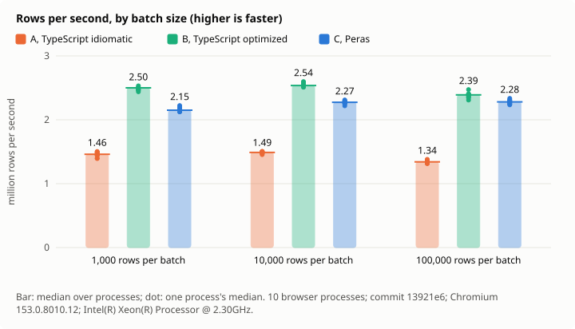

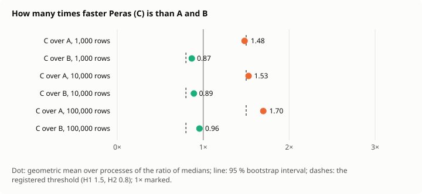

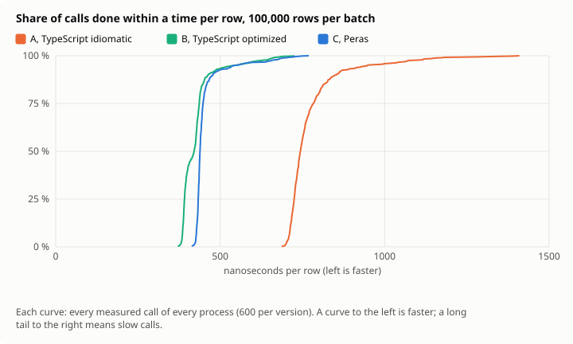


Pourquoi Peras n’est pas plus rapide est la question suivante ; elle est profilée dans [les constats](../findings.md), une étape retirée à la fois.

## Exécution 2 : après les littéraux statiques

Mesurée au commit `9f9754b`, protocole inchangé, après un changement du compilateur : les littéraux de chaîne seulement lus sont prêtés depuis un en-tête statique au lieu d’être copiés à chaque usage (décision 0016, constat F211). L’exécution 1 est gardée dans [bench/stream/run-1](../../../bench/stream/run-1/RESULTS.md) ; le [rapport](../../../bench/stream/run-2/RESULTS.md) de l’exécution 2 et le temps de chaque appel sont dans [results.json](../../../bench/stream/run-2/results.json). Les trois calculs ont de nouveau concordé sur chaque lot.

| Hypothèse                                           | Exécution 1 | Exécution 2, intervalle à 95 %        | Verdict      |
| --------------------------------------------------- | ----------- | ------------------------------------- | ------------ |
| H1, C au moins 1,5 fois plus rapide que A           | 1,53 ; 1,70 | 1,97 [1,95, 1,99] ; 2,18 [2,15, 2,21] | tient        |
| H2, C au moins 0,8 fois aussi rapide que B          | 0,89 ; 0,96 | 1,15 [1,14, 1,17] ; 1,21 [1,19, 1,24] | tient        |
| H3, les petits lots coûtent peu de plus             | 0,94        | 0,94 [0,91, 0,96]                     | tient        |
| H4, la frontière au plus 15 %                       | 5 %         | 6 % [6 %, 6 %]                        | tient        |
| H5, le 99e centile de C au plus 1,5 fois sa médiane | 1,61        | 1,57 [1,40, 1,66]                     | indéterminée |

**Ce que cela dit.** Peras traite maintenant le flux plus vite que le TypeScript écrit pour la vitesse, à chaque taille de lot : 1,11 fois à 1 000 lignes, 1,15 à 10 000, 1,21 à 100 000, chaque intervalle entièrement au-dessus de 1. Son temps par ligne est passé d’environ 440 à environ 338 ns ; A et B n’ont pas changé, à 2 % près. Les verdicts sont ceux de l’exécution 1, les seuils n’ayant pas été franchis autrement ; ce qui a changé, c’est le côté de 1 où se tient le rapport sur B. Ses appels lents restent indéterminés.

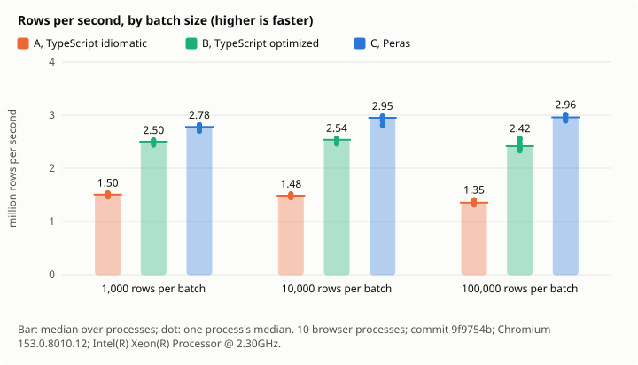

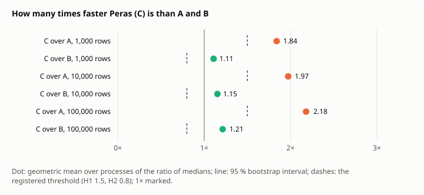

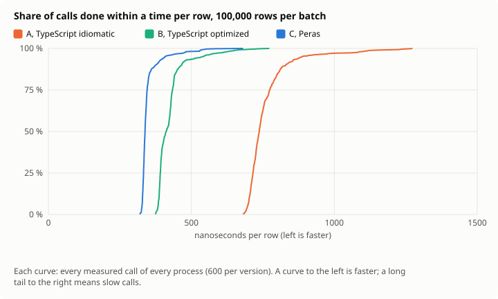

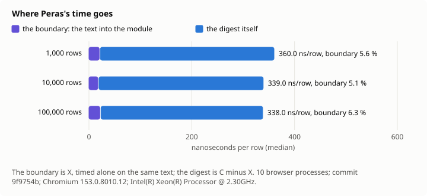

## Exécution 3 : après le runtime lié dans le module

Mesurée au commit `7470d08`, protocole inchangé, après un second changement du compilateur : le runtime est lié dans le module, pour que ses appels soient internes à un seul module (décision 0016, constat F212). L’exécution 2 est gardée dans [bench/stream/run-2](../../../bench/stream/run-2/RESULTS.md) ; le [rapport](../../../bench/stream/run-3/RESULTS.md) de l’exécution 3 et le temps de chaque appel sont dans [results.json](../../../bench/stream/run-3/results.json). Les trois calculs ont concordé sur chaque lot.

**Un écart.** Pendant l’exécution, un fichier a été modifié, sans être compilé : `fuzz/fuzz_targets/pipeline.rs`, pour ajouter le champ `link` qui manquait à sa compilation dans le CI. La cible de fuzzing ne fait pas partie de ce qui est mesuré, et rien n’a été compilé avant la fin de l’exécution ; le script a lu l’arbre comme propre à son départ.

| Hypothèse                                           | Exécution 1 | Exécution 2 | Exécution 3, intervalle à 95 %        | Verdict |
| --------------------------------------------------- | ----------- | ----------- | ------------------------------------- | ------- |
| H1, C au moins 1,5 fois plus rapide que A           | 1,53 ; 1,70 | 1,97 ; 2,18 | 2,22 [2,20, 2,24] ; 2,46 [2,43, 2,49] | tient   |
| H2, C au moins 0,8 fois aussi rapide que B          | 0,89 ; 0,96 | 1,15 ; 1,21 | 1,31 [1,29, 1,34] ; 1,41 [1,37, 1,44] | tient   |
| H3, les petits lots coûtent peu de plus             | 0,94        | 0,94        | 0,94 [0,92, 0,95]                     | tient   |
| H4, la frontière au plus 15 %                       | 5 %         | 6 %         | 7 % [7 %, 7 %]                        | tient   |
| H5, le 99e centile de C au plus 1,5 fois sa médiane | 1,61        | 1,57        | 1,75 [1,502, 1,88]                    | réfutée |

**Ce que cela dit.** Peras est maintenant 1,26, 1,31 et 1,41 fois plus rapide que le TypeScript écrit pour la vitesse à 1 000, 10 000 et 100 000 lignes, et 2,10 à 2,46 fois plus rapide que le TypeScript tel qu’on l’écrit ; son temps par ligne est passé d’environ 338 à environ 305 ns, A et B inchangés à 4 % près. H5 est réfutée, de justesse : le bas de son intervalle, 1,502, est juste au-dessus de son seuil. Sa médiane a baissé, ses appels les plus lents non : à 100 000 lignes, le 99e centile vaut 53 ms à l’exécution 2 comme à la 3, quand la médiane est passée de 33,8 à 30,5 ms. Ce que contiennent les appels les plus lents, le ramasse-miettes de la page ou la croissance de la mémoire du module, n’est pas mesuré ici.

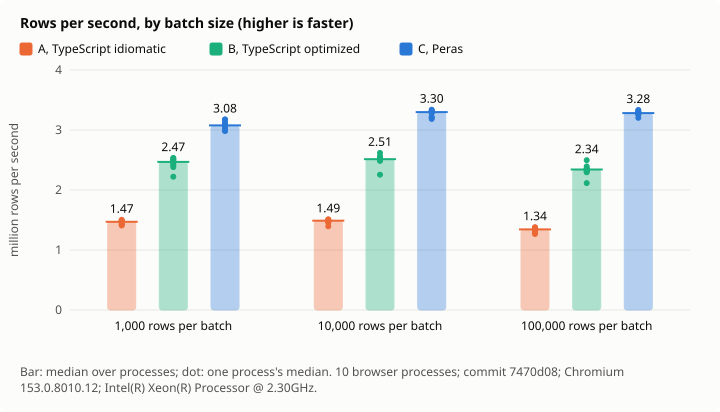

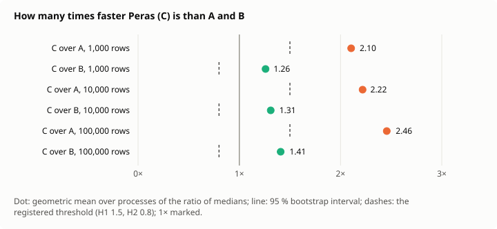


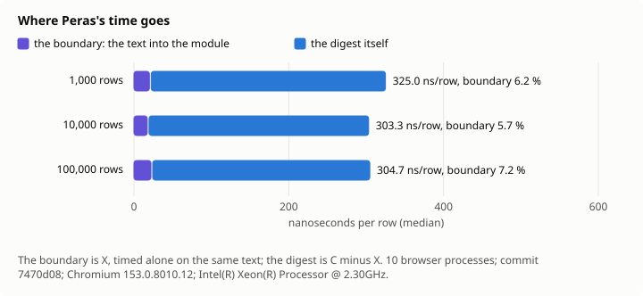

## Exécution 4 : après une valeur de repli construite seulement si besoin, et les petits blocs gardés pour réutilisation

Mesurée au commit `99f9202`, protocole inchangé, après deux autres changements : `unwrapOr` ne construit une valeur de repli qui ne fait que créer des littéraux que si l’option est vide (constat F209), et l’allocateur TLSF garde les petits blocs libérés pour la prochaine allocation de leur taille (constat F213). L’exécution 3 est gardée dans [bench/stream/run-3](../../../bench/stream/run-3/RESULTS.md) ; le [rapport](../../../bench/stream/run-4/RESULTS.md) de l’exécution 4 et le temps de chaque appel sont dans [results.json](../../../bench/stream/run-4/results.json). Les trois calculs ont concordé sur chaque lot ; rien d’autre n’a tourné pendant l’exécution.

| Hypothèse                                           | Exéc. 1     | Exéc. 2     | Exéc. 3     | Exéc. 4, intervalle à 95 %            | Verdict |
| --------------------------------------------------- | ----------- | ----------- | ----------- | ------------------------------------- | ------- |
| H1, C au moins 1,5 fois plus rapide que A           | 1,53 ; 1,70 | 1,97 ; 2,18 | 2,22 ; 2,46 | 2,96 [2,92, 3,01] ; 3,35 [3,30, 3,40] | tient   |
| H2, C au moins 0,8 fois aussi rapide que B          | 0,89 ; 0,96 | 1,15 ; 1,21 | 1,31 ; 1,41 | 1,78 [1,74, 1,84] ; 1,94 [1,87, 2,00] | tient   |
| H3, les petits lots coûtent peu de plus             | 0,94        | 0,94        | 0,94        | 0,91 [0,87, 0,94]                     | tient   |
| H4, la frontière au plus 15 %                       | 5 %         | 6 %         | 7 %         | 10 % [10 %, 10 %]                     | tient   |
| H5, le 99e centile de C au plus 1,5 fois sa médiane | 1,61        | 1,57        | 1,75        | 1,79 [1,57, 1,85]                     | réfutée |

**Ce que cela dit.** Peras est maintenant 1,70, 1,78 et 1,94 fois plus rapide que le TypeScript écrit pour la vitesse à 1 000, 10 000 et 100 000 lignes, et 2,81 à 3,35 fois plus rapide que le TypeScript tel qu’on l’écrit ; son temps par ligne est passé d’environ 305 à environ 218 ns, A et B inchangés à 5 % près. Depuis l’exécution 1, le temps par ligne de Peras a été divisé par deux, depuis environ 440 ns, les versions TypeScript et le protocole inchangés. La part de la frontière a grandi jusqu’à 10 %, parce que ce qui l’entoure est devenu plus rapide, pas elle. H5 reste réfutée : les appels les plus lents ont baissé, le 99e centile de 53 à 39 ms, mais moins que la médiane, de 30,5 à 21,8 ms.

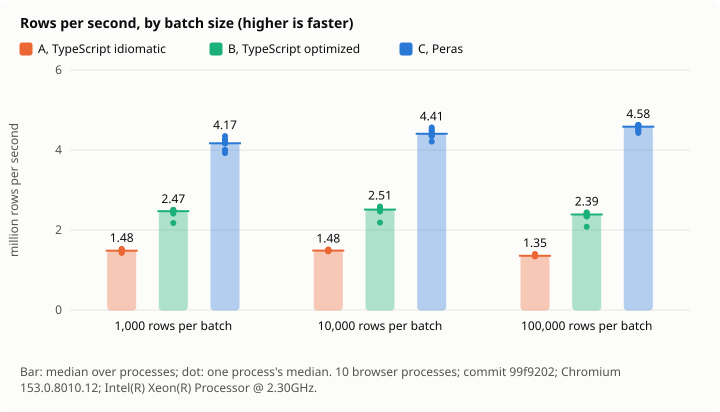

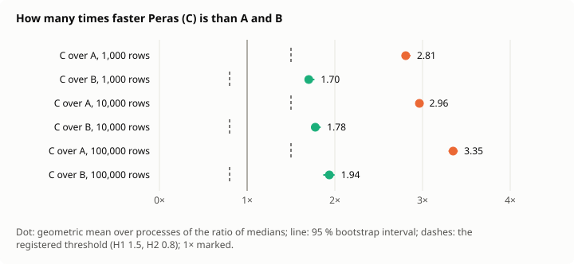

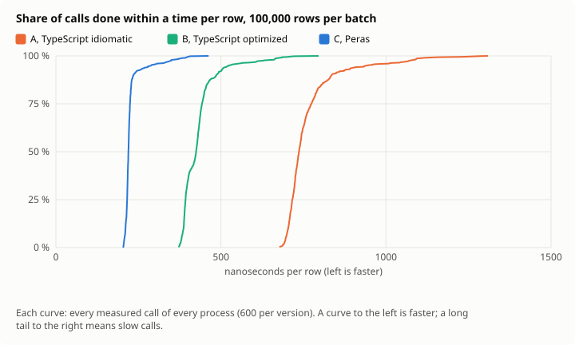

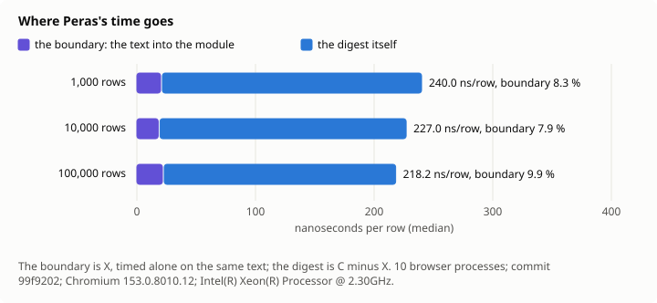

## Exécution 5 : après une clé de table cherchée une fois

Mesurée au commit `82641f4`, protocole inchangé, après un changement de plus : une passe sur l’IR cherche une clé une fois là où la table ne peut pas avoir changé entre deux recherches (constat F210). L’exécution 4 est gardée dans [bench/stream/run-4](../../../bench/stream/run-4/RESULTS.md) ; le [rapport](../../../bench/stream/RESULTS.md) de l’exécution 5 et le temps de chaque appel sont dans [results.json](../../../bench/stream/results.json). Les trois calculs ont concordé sur chaque lot ; rien d’autre n’a tourné pendant l’exécution.

| Hypothèse                                           | Exéc. 1     | Exéc. 4     | Exéc. 5, intervalle à 95 %            | Verdict      |
| --------------------------------------------------- | ----------- | ----------- | ------------------------------------- | ------------ |
| H1, C au moins 1,5 fois plus rapide que A           | 1,53 ; 1,70 | 2,96 ; 3,35 | 3,22 [3,17, 3,29] ; 3,61 [3,55, 3,68] | tient        |
| H2, C au moins 0,8 fois aussi rapide que B          | 0,89 ; 0,96 | 1,78 ; 1,94 | 1,90 [1,87, 1,92] ; 2,04 [1,99, 2,07] | tient        |
| H3, les petits lots coûtent peu de plus             | 0,94        | 0,91        | 0,93 [0,88, 0,95]                     | tient        |
| H4, la frontière au plus 15 %                       | 5 %         | 10 %        | 11 % [10 %, 11 %]                     | tient        |
| H5, le 99e centile de C au plus 1,5 fois sa médiane | 1,61        | 1,79        | 1,71 [1,42, 2,02]                     | indéterminée |

**Ce que cela dit.** Peras est 1,83, 1,90 et 2,04 fois plus rapide que le TypeScript écrit pour la vitesse à 1 000, 10 000 et 100 000 lignes, et 3,05 à 3,61 fois plus rapide que le TypeScript tel qu’on l’écrit ; environ 204 ns par ligne, contre 218 à l’exécution 4 et 440 à l’exécution 1. H5 est de nouveau indéterminée : son intervalle contient maintenant son seuil, ses appels les plus lents variant davantage d’un processus à l’autre.

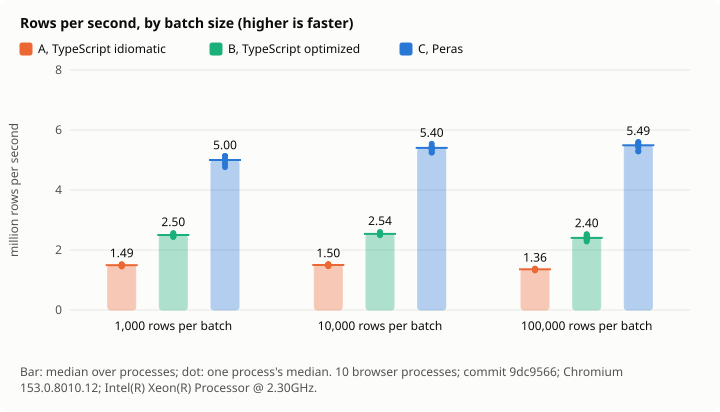

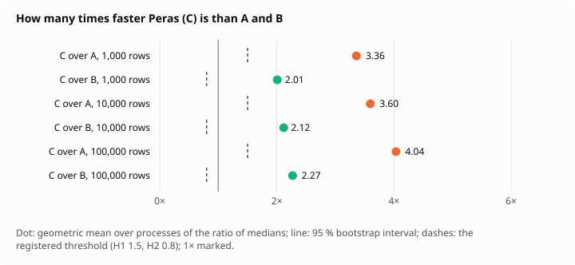


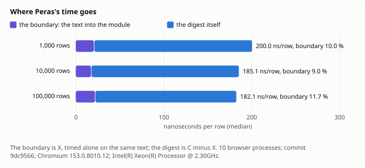
