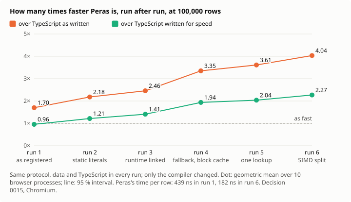

# 0016 : Rendre le compilateur plus rapide, d’après ce qui a été mesuré et ce qui est publié

_English version: [../../en/decisions/0016-faster-from-the-literature.md](../../en/decisions/0016-faster-from-the-literature.md)._

_Statut : proposée le 2026-11-11, close le 2026-11-12 (voir le [Bilan](#bilan)). Chaque changement est mesuré quand il arrive, par une nouvelle exécution du protocole de la [décision 0015](0015-stream-measured.md), inchangé ; un changement qui n’y montre pas son gain est rapporté comme tel._

## Contexte

La décision 0015 a mesuré le calcul de l’application de flux sous un protocole enregistré : Peras est 1,5 à 1,7 fois plus rapide que le TypeScript tel qu’on l’écrit, mais 0,87 à 0,96 fois aussi rapide que le TypeScript écrit pour la vitesse. Un profil par retrait (`node scripts/profile-stream.mjs`) a ensuite trouvé où va le temps, pour 1 000 000 de lignes, sur environ 363 ms :

| Étape                                                               | Coût                          | Constat                |
| ------------------------------------------------------------------- | ----------------------------- | ---------------------- |
| Vérifier les lettres d’une zone avec `for (const c of s.split(""))` | 90 à 98 ms                    | [F207](../findings.md) |
| Découper chaque ligne en un tableau de champs                       | 40 à 58 ms                    | [F208](../findings.md) |
| Rendre `Option<Reading>`, et la valeur de repli de `unwrapOr`       | 35 à 55 ms                    | [F209](../findings.md) |
| `has` puis `get` sur une table à clés texte                         | 41 à 44 ms                    | [F210](../findings.md) |
| Parcourir les lignes                                                | environ 33 ms                 |                        |
| Lire les nombres                                                    | environ 30 ms en tout, bruité |                        |

Aucun de ces coûts ne vient de WebAssembly : la frontière fait 5 % (0015, H4). Chacun est un travail que le compilateur fait faire au programme sans qu’il l’ait demandé : un tableau qu’il ne garde jamais, un bloc pour une valeur qui vit un instant, un hachage calculé deux fois. Les compilateurs savent retirer chacun d’eux depuis des décennies. Cette décision liste, pour chacun, la technique publiée, comment elle s’appliquerait à Peras, et ce qu’elle devrait économiser.

## Les techniques

**1. Fusionner le parcours des caractères avec ce qui le consomme** (F207). Coutts, Leshchinskiy et Stewart, _Stream Fusion: From Lists to Streams to Nothing at All_, ICFP 2007, retirent la liste intermédiaire entre un producteur et son consommateur en les changeant tous deux en flux et en les fusionnant. Peras le fait déjà pour `for (const part of text.split(sep))` avec un séparateur littéral (F206), pas pour le séparateur vide. Le changement : le même parcours au fil de l’eau pour `split("")`, un caractère à la fois dans une seule vue, et `charCodeAt(i)` pour vérifier une classe de caractères sur un entier, sans aucune chaîne. **Attendu** : l’essentiel des 90 ms ; la vérification devient une boucle sur des octets.

**2. Trouver la recherche redondante et la faire une fois** (F210). Morel et Renvoise, _Global Optimization by Suppression of Partial Redundancies_, Communications of the ACM 22(2), 1979, retirent un calcul fait deux fois sur un chemin. Ici, le calcul est la recherche d’une clé : `m.has(k)` puis `m.get(k)`, ou `m.get(k)` puis `m.set(k, …)`, sans changement de `m` ni de `k` entre les deux. Le changement : l’IR reconnaît la paire et garde l’emplacement trouvé par la première. SipHash reste (Aumasson et Bernstein, INDOCRYPT 2012) : il protège contre des clés choisies pour entrer en collision, et le changement divise par deux le nombre de fois où il tourne. **Attendu** : environ la moitié des 41 à 44 ms.

**3. Ne pas allouer ce qui ne s’échappe pas** (F208). Choi, Gupta, Serrano, Sreedhar et Midkiff, _Escape Analysis for Java_, OOPSLA 1999, trouvent les objets qui ne survivent pas à la méthode qui les crée et les allouent sur sa pile. Tofte et Talpin, _Region-Based Memory Management_, Information and Computation 132(2), 1997, infèrent où la mémoire peut être libérée d’un coup. Reinking, Xie, de Moura et Leijen, _Perceus: Garbage Free Reference Counting with Reuse_, PLDI 2021, réutilisent un bloc libéré juste avant une allocation de même taille. Le changement : un tableau de vues créé dans le corps d’une boucle et qui n’en sort pas réutilise un même bloc d’une itération à l’autre. **Attendu** : l’essentiel des 40 à 58 ms.

**4. Rendre les petites valeurs en valeurs** (F209). La même analyse d’échappement s’applique au résultat d’une fonction : un `Option` de structure que l’appelant déballe aussitôt n’a pas besoin d’être un bloc du tas ; les résultats multiples de WebAssembly peuvent le porter. Et `unwrapOr(repli)` n’évalue sa valeur de repli que si la valeur manque, comme `??` en JavaScript, ce que demande F104. **Attendu** : l’essentiel des 35 à 55 ms.

**5. Parcourir plusieurs octets à la fois** (lignes, champs, nombres). Langdale et Lemire, _Parsing Gigabytes of JSON per Second_, The VLDB Journal 28(6), 2019, trouvent les caractères structurants d’un texte avec des instructions SIMD, plusieurs octets par instruction. WebAssembly a un SIMD de 128 bits, que Peras utilise déjà dans les boucles. Le changement : `split` et le parcours au fil de l’eau cherchent leur séparateur 16 octets à la fois. Lemire, _Number Parsing at a Gigabyte per Second_, Software: Practice and Experience 51(8), 2021, lit les décimaux exactement sans le chemin lent dans la plupart des cas ; le `parseF64` de Peras utilise le chemin rapide de Clinger (_How to Read Floating Point Numbers Accurately_, PLDI 1990) et demande à l’hôte au-delà. **Attendu** : une part des 33 ms des lignes et des nombres ; plus petite, et plus tard.

## Ordre

Par gain sur coût, chacun mesuré avant le suivant :

1. Caractères au fil de l’eau et `charCodeAt` (technique 1).
2. Une seule recherche pour `has` ou `get` puis `get` ou `set` d’une même clé (technique 2).
3. Réutilisation du tableau de vues du corps d’une boucle (technique 3).
4. `Option` de structure rendu en valeurs, et `unwrapOr` paresseux (technique 4).
5. Recherche SIMD des séparateurs (technique 5).

Si 1 à 4 donnent chacun l’essentiel de ce que montre le profil, le calcul passe d’environ 363 à environ 200 ms pour 1 000 000 de lignes : plus rapide que le TypeScript écrit pour la vitesse (B, environ 418 ms à 100 000 lignes dans 0015). C’est un espoir, pas un résultat : un profil par retrait donne le maximum qu’un changement peut économiser, et les moteurs de TypeScript progressent aussi. Chaque exécution de 0015 dira ce qui en tient.

## Ce qui ne change pas

- Le protocole de 0015, ses versions A et B, et ses seuils. Le programme Peras de l’application n’est pas réécrit à la main pour gagner : le gain doit venir du compilateur, pour tout programme écrit simplement.
- La sûreté : chaque changement garde les vérifications de l’allocateur de debug, le vérificateur de release et les tests des deux modes. Un bloc réutilisé reste un bloc dont le vérificateur peut rendre compte.

## Mesuré après l’étape 1

L’étape 1, les caractères de `split("")` parcourus au fil de l’eau, est faite : juste et testée, elle n’a fait gagner aucun temps (constat M013). Son profil a été refait, une chose retirée à la fois, et deux coûts qu’il cachait ont été mesurés :

- **Les allocations** (F211). Le calcul alloue 7 blocs du tas par ligne et en libère 7 : un littéral de chaîne copié à chaque usage, la vue d’un `split`, un curseur, deux copies. Une allocation et sa libération coûtent environ 13 ns : environ 90 ns par ligne, un quart du temps.
- **Les appels au runtime** (F212). Le runtime est sa propre instance ; un appel par un import coûte 2,06 ns dans Chromium, contre 0,73 pour un appel interne au module, que le moteur intègre (`node scripts/call-cost.mjs`). Le calcul fait 30 de ces appels par ligne : environ 40 ns, 11 % du temps.

L’ordre change donc. D’abord, **les littéraux en blocs statiques** (F211) : prêtés sans copie, jamais libérés ; c’est petit, et cela retire trois des sept allocations de chaque ligne. Ensuite, **le runtime lié dans le module** (F212) : cela retire le surcoût de chaque appel, environ 11 %, et laisse le moteur intégrer les petites fonctions du runtime, ce qui peut donner plus ; cette part n’est pas encore mesurée. Puis les étapes ci-dessus, qui retirent chacune une allocation.

## Bilan

Close le 2026-11-12, après six exécutions de la décision 0015, toutes sous son protocole enregistré, avec les mêmes données, le même TypeScript et les mêmes seuils. Seuls le compilateur et son runtime ont changé. Le calcul de Peras, à 100 000 lignes dans Chromium :

| Exéc. | Commit    | Ce qui est arrivé avant elle                                                                                | Peras, ns par ligne | Peras sur B, intervalle à 95 % |
| ----- | --------- | ----------------------------------------------------------------------------------------------------------- | ------------------- | ------------------------------ |
| 1     | `13921e6` | rien : le compilateur tel que la 0015 l’a enregistré                                                        | 438,5               | 0,96 [0,93, 0,97]              |
| 2     | `9f9754b` | les littéraux de texte en blocs statiques (F211)                                                            | 338,0               | 1,21 [1,19, 1,24]              |
| 3     | `7470d08` | le runtime lié dans le module (F212)                                                                        | 304,7               | 1,41 [1,37, 1,44]              |
| 4     | `99f9202` | un repli calme de `unwrapOr` construit seulement s’il sert (F209), un cache des petits blocs libérés (F211) | 218,2               | 1,94 [1,87, 2,00]              |
| 5     | `82641f4` | une recherche dans la table au lieu de deux (F210)                                                          | 204,2               | 2,04 [1,99, 2,07]              |
| 6     | `9dc9566` | le séparateur cherché 16 octets à la fois, un bloc par split, un pas de caractère (F207, F208)              | 182,1               | 2,27 [2,23, 2,31]              |

Le TypeScript écrit pour la vitesse (B) est resté entre 413,9 et 427,1 ns par ligne sur les six exécutions, et le TypeScript tel qu’on l’écrit (A) entre 729,3 et 745,9. Le temps par ligne de Peras a baissé de 2,4 fois. Peras est passé de 0,96 fois aussi rapide que B à 2,27 fois, et de 1,70 fois plus rapide que A à 4,04 fois. L’espoir écrit plus haut était d’environ 200 ms pour 1 000 000 de lignes. L’exécution 6 donne 182 ns par ligne, 182 ms pour 1 000 000, et le profil dans Node environ 181 ms.

**Ce qui n’a pas donné ce qui était attendu**

- L’étape 1, les caractères parcourus au fil de l’eau, n’a rien fait gagner seule (M013). Le profil avait mis le coût sur le tableau, alors qu’il était dans les appels et les allocations. Les retirer, aux exécutions 2 à 4, a donné l’essentiel du gain.
- Deux premiers essais sur la recherche n’ont rien donné et ont été retirés (F210) :
  - un hachage mémorisé ;
  - des clés comparées 8 octets à la fois.
- H5, les appels lents, reste réfutée : 1,74 [1,66, 1,81] à l’exécution 6. Les appels les plus lents baissent moins que la médiane. Aucune de ces techniques ne les visait.

**Ce qui n’a pas été fait, et pourquoi**

- La technique 3 complète, une analyse d’échappement : pas faite. Deux pas plus petits en ont pris l’essentiel du gain :
  - un split crée un bloc au lieu d’un par champ ;
  - un bloc libéré de même taille est réutilisé par le cache.
- `Option` rendu en valeurs WebAssembly (technique 4) : pas fait. Le repli paresseux a pris l’essentiel de ce que F209 mesurait.
- La lecture des nombres de Lemire : pas faite. Les nombres pèsent peu dans le temps. `parseF64` lit aujourd’hui les décimaux exactement, et le changer risque sa justesse pour un petit gain.

**Sûreté**

Chaque étape a gardé les vérifications de l’allocateur de debug, le vérificateur de release et les tests de bout en bout des deux allocateurs. À partir de la passe de recherche, chaque optimisation a aussi passé :

- le test différentiel (M015) : des programmes aléatoires exécutés de cinq façons, qui doivent concorder et ne laisser aucun bloc vivant ;
- 2 000 de ces programmes une fois ;
- une exécution avec l’optimisation cassée exprès, que le test a détectée.

Un programme écrit simplement a ces gains sans rien changer. Le source Peras de l’application de flux n’a pas été réécrit pour gagner.
