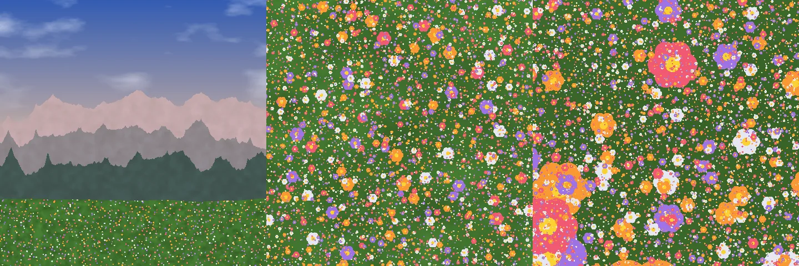

# Le jardin d’Apeiron

_Version anglaise, qui fait foi : [../en/garden.md](../en/garden.md)._

_Peras_, en grec, c’est la limite ; _apeiron_, l’illimité. Pour les pythagoriciens, tout ce qui est bon naît de la limite imposée à l’illimité. Le jardin d’Apeiron est cette idée sous forme de programme : un paysage sans fin, un ciel, des montagnes et une prairie, né de quelques règles finies, qui gagne des détails aussi loin qu’on le zoome.

C’est aussi une mesure. Le plus court programme qui dessine une image est sa meilleure compression ; une scène calculée pixel par pixel s’étire comme une image vectorielle, et, contrairement à elle, ajoute des détails à mesure qu’on zoome. Combien plus petite, combien plus nette, à quelle vitesse, à quel coût : la [décision 0013](decisions/0013-garden-of-apeiron.md) l’a demandé sous un protocole enregistré avant toute mesure, et rapporte ce qu’elle a trouvé, l’hypothèse réfutée comprise.

## Avant, après


Le même coin du jardin, zoomé 8 puis 64 fois. À gauche, l’image stockée : le plus petit AVIF de la scène entière qui paraît juste en pleine taille, 9,5 Ko, agrandi comme un visualiseur l’agrandit ; à ×64, 16 de ses pixels remplissent le cadre. À droite, le programme, 5,7 Ko, dessinant la fenêtre à ce zoom. Leur ressemblance, par le SSIM, est de 0,22 à ×8 et de 0,20 à ×64. Même le PNG sans perte, 471 Ko, n’a que 16 pixels de large à ×64 : aucune image stockée ne peut dessiner les fleurs qu’elle ne contient pas.

## Trois zooms



Chaque doublement du zoom ajoute une octave à chaque bruit et une sorte de fleur plus petite. Le coût d’un pixel ne croît qu’avec le logarithme du zoom.

## Ce qui a été mesuré

Sous le protocole, sur une seule machine, dans Chromium ; les [résultats](../../bench/garden/RESULTS.md), et chaque nombre dans [results.json](../../bench/garden/results.json).

| Hypothèse                                     | Verdict     | Mesuré                                                        |
| --------------------------------------------- | ----------- | ------------------------------------------------------------- |
| Les mêmes pixels en TypeScript, Peras et Rust | oui         | bit pour bit, aux zooms 1, 4, 16 et 64                        |
| H1, le programme est plus petit que son image | tient       | 5 872 octets contre 9 774 pour le plus petit AVIF à SSIM 0,95 |
| H2, une image stockée grandit avec le zoom    | tient       | à ×64, 4 452 fois les octets de ×1 ; 142 fois au moins        |
| H3, Peras 1,3 fois plus rapide que TypeScript | **réfutée** | 1,19 fois TypeScript, 1,11 fois Rust                          |
| H4, l’œil pardonne de loin                    | tient       | chaque format avec perte gagne réduit 4 fois                  |
| H5, la sûreté ne coûte rien à l’image         | tient       | les vérifications de débordement coûtent 2 % en debug         |

## Ce qu’il ne dit pas

- **Que Peras est le plus petit.** Le même programme en TypeScript se livre en 1 119 octets, cinq fois moins : c’est la scène procédurale qui bat son image, et Peras porte le poids de son runtime WebAssembly.
- **Que Peras est beaucoup plus rapide.** 1,19 fois TypeScript sur des boucles flottantes, en deçà des 1,3 fois enregistrés : l’hypothèse est réfutée, et dite telle.
- **Que cela vaut pour toute image.** Un paysage de bruit convient au procédural ; une photographie n’a pas de programme court.
- **Que le SSIM est l’œil.** C’est un modèle de la perception parmi d’autres ; des modèles plus proches, Butteraugli et SSIMULACRA2, sont laissés à une exécution ultérieure.

## La relancer

```sh
cargo build --release -p perasc
node scripts/bench-garden.mjs          # les mesures, sous le protocole
node scripts/garden-showcase.mjs       # l’avant-après, ses nombres calculés
node scripts/bench-garden.mjs --check  # les mêmes pixels partout, comme le vérifie la CI
```

Les trois versions : [TypeScript](../../bench/garden/garden.ts), la référence ; [Peras](../../bench/garden/garden.peras) ; [Rust](../../bench/garden/rust/src/lib.rs). Chacune n’utilise que des opérations qu’IEEE 754 définit exactement et une empreinte entière, pour que les trois dessinent le même jardin.
