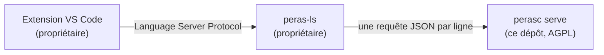

# Éditeurs

_Version anglaise : [../../en/guide/editors.md](../../en/guide/editors.md)._

Peras a un serveur de langage et une extension VS Code. Tous deux sont **propriétaires**, gardés dans un dépôt privé à part de celui-ci, comme le fixe la [décision 0006](../decisions/0006-licensing.md) : leur code n’est pas publié ici. Cette page dit ce qu’ils font, comment ils atteignent Peras, et où ils en sont. Ils ne sont pas encore distribués.

## Ce que donne l’extension

Dans un fichier `.peras` ou `.apeiron` :

| Fonction                                                                        | État    |
| ------------------------------------------------------------------------------- | ------- |
| les erreurs à la frappe, avec leurs codes, comme `perasc check`                 | fait    |
| le survol : ce qu’est un nom, et son type                                       | fait    |
| aller à la définition, dans le fichier ou dans un fichier qu’il importe         | fait    |
| trouver chaque référence                                                        | fait    |
| le plan d’un fichier : fonctions, structures, énumérations, variables de module | fait    |
| la complétion : les champs et méthodes après un `.`, les noms visibles          | fait    |
| formater le document, comme `perasc fmt` ([formatage](formatting.md))           | fait    |
| les commentaires et crochets des deux langages                                  | fait    |
| le renommage                                                                    | ensuite |

Deux réglages, `peras.serverPath` et `peras.perascPath`, nomment le serveur de langage et `perasc` quand ils ne sont pas dans le `PATH`.

## Comment il atteint Peras

Les outils n’utilisent Peras qu’à travers ce que Peras publie, jamais son code :

- **`perasc serve`**, dans ce dépôt ([décision 0042](../decisions/0042-queries.md), son protocole dans [`perasc serve`](../reference/serve.md)), garde chaque fichier ouvert avec son analyse, et répond diagnostics, survol, définition, références, symboles, complétion et formatage, en un dixième de milliseconde environ. Tout outil peut s’en servir.
- **`peras-ls`**, le serveur de langage, écrit en Rust avec une seule dépendance, traduit le Language Server Protocol de l’éditeur vers `perasc serve` et retour, positions comprises (l’éditeur compte des unités UTF-16 depuis 0, `perasc` des caractères depuis 1).
- **L’extension** est un client de ce protocole écrit sur la seule API de VS Code, sans paquet à l’exécution.

Ce dont un outil a besoin et que Peras ne publie pas est d’abord ajouté à Peras, par une décision à lui, en public.

## Où ils en sont, mesurés

Chacun a été choisi par une décision à lui, ses options construites et mesurées, comme dans ce dépôt. Les chiffres, sur la machine de ces mesures :

- **Les cinquante réponses** du banc de requêtes de Peras (`bench/query`), demandées par LSP puis par les commandes de VS Code lui-même : toutes les cinquante justes, vérifiées par la CI du dépôt privé contre un commit fixé de Peras.
- **Les premières erreurs** apparaissent environ 0,2 s après l’ouverture d’un fichier, l’extension pas encore démarrée ; une requête sur le plus grand fichier Peras de ce dépôt répond en 0,2 à 0,4 ms.
- **Ce qu’ils pèsent** : le binaire du serveur de langage, environ 0,76 Mo, 2,6 Mo de mémoire avec six fichiers ouverts ; l’extension, un paquet d’environ 5 Ko.

## Ensuite

- Le renommage, à partir des références de `perasc serve`.
- L’analyseur de fuites mémoire, l’autre outil propriétaire que prévoit la [feuille de route](../reference/roadmap.md), bâti sur les contrôles de l’allocateur de débogage, qui restent dans le cœur ouvert.
- La distribution de l’extension, quand le propriétaire le décidera.
