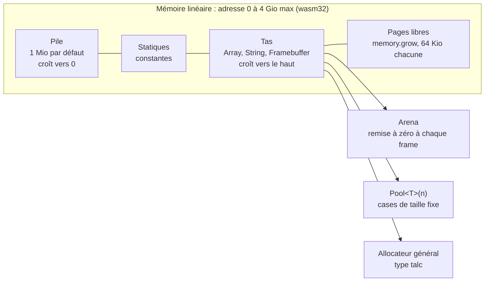
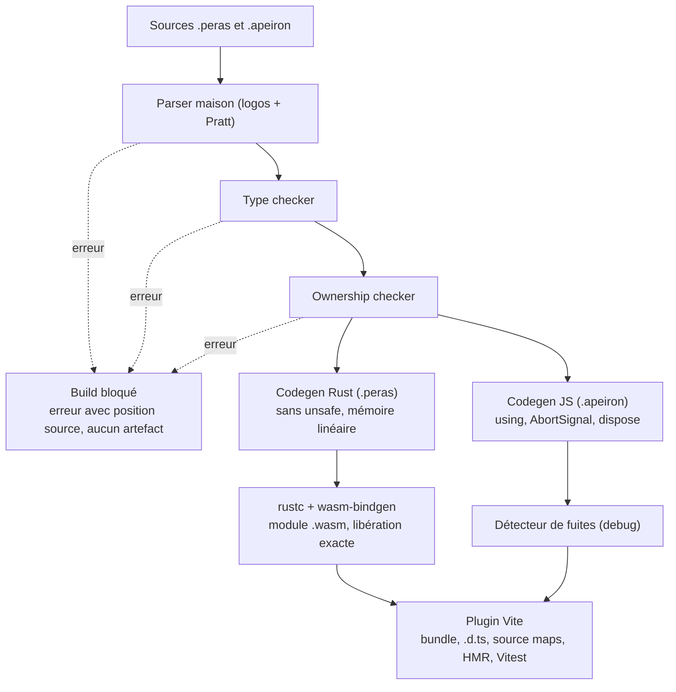

# Peras — Spec initiale du langage

_Dernière mise à jour : 2026-11-03. Traduction de [la version anglaise](../en/spec.md), qui fait foi._

## Vision et objectifs

Peras est un langage à syntaxe TypeScript, compilé en WebAssembly pour les modules owned et en JavaScript pour les modules managed, avec une sûreté mémoire vérifiée à la compilation et sans ramasse-miettes dans les zones critiques.

Trois piliers guident chaque décision de conception :

1. **Rasterisation** : produire des pixels est une fonction native du langage, avec des framebuffers typés, partagés sans copie avec le Canvas.
2. **Gestion mémoire** : propriété unique, libération déterministe, aucune allocation cachée dans une boucle de rendu.
3. **Syntaxe accessible** : un développeur TypeScript lit et écrit du Peras en une journée, sans annotation de durée de vie.

Ces piliers reposent sur une règle transversale : **la compilation est intransigeante et bavarde**. Il n'existe pas d'avertissement, chaque diagnostic bloque le build et explique la cause, l'historique de la valeur et la correction.

Principes complémentaires :

- **Deux modes** : `managed` pour l'UI et le DOM, `owned` pour le calcul et le rendu. Le compilateur contrôle les frontières.
- **Intégré** : plugin Vite, tests Vitest, types `.d.ts` générés pour consommer les modules depuis du JS.

Hors périmètre du MVP : remplacer JavaScript partout, le multithreading, un backend natif hors WASM.

## Nom et extensions

Le langage s'appelle **Peras**, et son extension indique le mode de chaque module : `.peras` pour `owned`, `.apeiron` pour `managed`.

- **Peras (πέρας), « la limite »** : chez les pythagoriciens puis dans le _Philèbe_ de Platon, tout ce qui est bon naît de la limite imposée à l'illimité. Le compilateur impose ses limites aux types, aux alias et aux durées de vie. La rasterisation impose une grille finie de pixels à une géométrie continue.
- **Apeiron (ἄπειρον), « l'illimité »** : le monde ouvert, côté JS et GC, que Peras discipline sans le contraindre entièrement.
- **L'extension est le mode** : aucune déclaration `owned module` ou `managed module` en tête de fichier. Le plugin Vite route chaque fichier vers son backend, et l'arborescence montre d'un coup d'œil quel code vit sous contrainte.
- **Outils** : compilateur `perasc`, plugin `vite-plugin-peras`, scaffolding `pnpm create peras`.
- **Vérifications** : aucun langage, paquet npm ou crate nommé Peras trouvé, ni format de fichier `.peras` ou `.apeiron`. Reste à vérifier la marque (INPI, EUIPO) et à réserver npm, crates.io, l'organisation GitHub et le domaine.

## Sous-ensemble de TypeScript

Peras garde la syntaxe TS mais retire tout ce qui empêche une analyse statique complète.

| Élément                                 | Statut                   | Raison                                             |
| --------------------------------------- | ------------------------ | -------------------------------------------------- |
| `let`, `const`, fonctions, flèches      | Gardé                    | Base du langage                                    |
| `interface`, `type`, unions, génériques | Gardé                    | Cœur du typage                                     |
| `class` sans héritage                   | Gardé                    | Héritage remplacé par la composition et les traits |
| `enum` et unions discriminées           | Gardé                    | Avec `match` exhaustif                             |
| `async` / `await`                       | Mode `managed` seulement | Repose sur les Promises JS                         |
| `any`, `unknown` non narrowé            | Retiré                   | Contourne le typage                                |
| `eval`, `new Function`, `with`          | Retiré                   | Code dynamique impossible à analyser               |
| Prototypes, `this` dynamique            | Retiré                   | Ownership indéterminable                           |
| `null` / `undefined` implicites         | Retiré                   | Remplacés par `Option<T>`                          |
| Exceptions `throw`                      | Retiré en `owned`        | Remplacées par `Result<T, E>`                      |
| `number` générique                      | Retiré en `owned`        | Types explicites `i32`, `i64`, `f32`, `f64`, `u8`  |

Ajouts : `match`, l'opérateur `?` sur `Result`, les conventions de passage `inout` et `sink`. Le mode d'un module est fixé par son extension, pas par un mot-clé.

## Système de types

Le typage est statique, fort et sans échappatoire. L'inférence locale évite d'annoter chaque variable.

- **Structurel en `managed`, nominal en `owned`** : un `UserId` et un `OrderId` de type `i64` ne sont pas interchangeables en zone critique.
- **Inférence locale** dans le corps des fonctions. Les signatures publiques sont toujours annotées.
- **Unions discriminées et narrowing** comme en TS, avec un `match` qui doit être exhaustif.
- **Génériques monomorphisés** : chaque instanciation produit du code spécialisé, sans coût à l'exécution.
- **Traits** à la place de l'héritage : `impl Display for User`.
- **Aucune conversion implicite** : `i32 + f64` est une erreur, il faut écrire `x.toF64() + y`.
- **Débordements vérifiés** en debug, avec des opérations explicites `wrappingAdd` et `checkedAdd`.

## Modèle mémoire

Peras utilise la sémantique de valeurs mutables (inspirée de Hylo) plutôt que les références de Rust. On obtient la sûreté mémoire sans annotations de durée de vie.

### Mode `owned`

- Chaque valeur a un seul propriétaire. Une affectation copie les types simples et déplace les autres.
- Aucune référence ne peut être stockée dans une structure. Il n'y a donc jamais de durée de vie à écrire.
- Passage de paramètres selon trois conventions :
  - `let` (défaut) : lecture seule, sans copie.
  - `inout` : modification exclusive. Le compilateur interdit tout alias pendant l'appel.
  - `sink` : la fonction consomme la valeur. L'appelant ne peut plus l'utiliser.
- Libération déterministe en fin de portée, sans GC.
- Partage explicite uniquement via `Rc<T>`, visible dans le type.

### Mode `managed`

Décision : le mode `managed` est compilé directement en JavaScript, pas en WasmGC. WasmGC repose sur le même GC que JS : il ne libère pas plus tôt et n'empêche aucune fuite. Il complique en revanche l'interop, le débogage, et oblige à un backend maison dès le MVP. Il reste une option post-MVP pour un module `managed` lourd en calcul.

En JS, une fuite n'est pas un oubli de libération mais une référence qui reste accrochée. Le compilateur applique donc l'ownership aux **ressources** et aux **références à longue durée de vie** :

- **RAII sur les ressources** : listeners, timers, observers, `AbortController`, WebSocket et nœuds DOM créés sont des `Resource` à propriétaire unique. Le compilateur insère leur libération en fin de portée via `using` et `Symbol.dispose`.
- **Listeners liés à un `AbortSignal`** : chaque `addEventListener` généré reçoit le signal de son propriétaire, et tout se détache avec lui.
- **Échappement des closures** : une closure enregistrée sur une cible durable (`window`, `document`, store global) ne peut pas capturer une valeur à durée de vie courte.
- **Collections globales bornées** : `Map` ou `Array` global mutable refusé. Il faut un `WeakMap` ou un `LruCache<K, V>(n)`.
- **DOM possédé par les composants** : le démontage libère le sous-arbre et ses ressources, sans nœud détaché orphelin.
- **Détecteur de fuites en debug** : un `FinalizationRegistry` signale toute `Resource` collectée sans avoir été libérée. C'est une erreur dans l'overlay Vite.
- **Accès natifs** : DOM, `async`/`await` et `requestAnimationFrame` sans glue, uniquement dans ce mode.

Limite assumée : un objet simple sans référence attend le passage du GC. Tout ce qui doit être libéré à l'instant (pixels, buffers audio, gros tableaux) reste en `owned`.

### Frontière entre les modes

- Une valeur `owned` passée à `managed` est copiée ou déplacée, jamais empruntée.
- Une valeur `managed` entre en `owned` par conversion explicite et validée : `Point.from(obj)?`.
- Une fonction `owned` ne peut pas appeler une fonction `managed`. L'inverse est autorisé.

## Pile, tas et allocation

Les modules `.peras` vivent dans la mémoire linéaire de WebAssembly : un seul bloc d'octets contigu, dont le compilateur connaît et borne chaque usage.



La mémoire grandit par pages de 64 Kio et ne rétrécit jamais. La pile est placée en premier : un débordement sort de la mémoire et arrête l'exécution au lieu d'écraser les données.

### Placement des valeurs

- **Scalaires** (`i32`, `f64`, `Rgba8`) : registres de la machine WASM, sans adresse mémoire.
- **Valeurs de taille fixe qui ne s'échappent pas** : pile. Sans référence stockée, l'analyse d'échappement est simple et exacte.
- **Valeurs de taille variable** (`Array`, `String`, `Framebuffer`) : tas.
- **Plan mémoire visible** : chaque type a une taille et un alignement fixes, affichés par `--verbose` et `sizeOf<T>()`.

### Garanties à la compilation

- **Profondeur de pile prouvée** : `perasc` calcule la pile maximale de chaque fonction et du graphe d'appels. Le build échoue si elle dépasse le budget.
- **Récursion bornée** : une fonction récursive doit déclarer sa profondeur maximale, sinon c'est une erreur.
- **`@frame` sans allocation** : aucune croissance mémoire n'est possible pendant le rendu.

### Budgets

Les limites sont déclarées dans `peras.config.ts` et vérifiées à la compilation, puis à l'exécution avec une erreur détaillée en cas de dépassement.

| Budget           | Exemple | Vérifié                           |
| ---------------- | ------- | --------------------------------- |
| Pile             | 256 Kio | compilation                       |
| Mémoire initiale | 32 Mio  | compilation (framebuffers inclus) |
| Tas maximal      | 64 Mio  | exécution                         |
| Plafond total    | 512 Mio | exécution                         |

### Allocateurs

- **Allocateur général** compact, du type `talc`, pour le tas courant.
- **`Arena`** : allocation par simple déplacement de pointeur, remise à zéro en une opération. Idéale pour les données temporaires d'une frame.
- **`Pool<T>(n)`** : `n` cases de taille fixe, sans fragmentation, pour les objets nombreux et identiques.

### Croissance mémoire et rendu

Quand la mémoire grandit, toutes les vues JS sur ce bloc deviennent invalides, y compris l'`ImageData` du `present` sans copie. Trois règles l'évitent :

1. Les framebuffers sont alloués à l'initialisation, avec une mémoire initiale dimensionnée pour eux.
2. `@frame` interdit toute allocation, donc toute croissance pendant le rendu.
3. `present` recrée sa vue à chaque frame, ce qui coûte presque rien et reste sûr après une croissance.

## Rasterisation

Le rendu de pixels fait partie de la bibliothèque standard et du système de types. Les pixels vivent en mémoire WASM `owned` et le Canvas les lit sans copie.

- **Types de pixels explicites** : `Rgba8`, `RgbaF32`, `Gray8`. Aucune conversion implicite entre formats, `px.toRgba8()` obligatoire.
- **Framebuffer `owned`** : `Framebuffer<Rgba8>` est un bloc contigu en mémoire linéaire. `present(fb)` crée une vue `ImageData` sur ce bloc et l'envoie au Canvas, sans copie.
- **Primitives natives** dans `std/raster` : lignes, triangles par fonctions d'arête, remplissage, blending alpha et mise à l'échelle. Elles sont vectorisées avec le SIMD 128 bits de WASM.
- **Accès pixel sûr** : `fb.at(x, y)` renvoie une `Option`. Les itérateurs `fb.rows()` et `fb.pixels()` éliminent les vérifications de bornes à la compilation.
- **Règle `@frame`** : une fonction annotée `@frame` ne peut ni allouer, ni appeler une fonction qui alloue. Le compilateur le prouve et refuse le build sinon.
- **Boucle de rendu** : la partie `managed` gère `requestAnimationFrame`, la partie `owned` dessine dans un framebuffer passé en `inout`.
- **Plus tard** : backend WebGPU pour les shaders, avec le même typage des formats.

```typescript
// render.peras — mode owned
import { Framebuffer, Rgba8, triangle } from "std/raster";

@frame
export fn draw(fb: inout Framebuffer<Rgba8>, t: f32): void {
  fb.clear(Rgba8.black());
  const a = Point(160.0 + 80.0 * t.sin(), 40.0);
  triangle(&fb, a, Point(60.0, 200.0), Point(260.0, 200.0), Rgba8(255, 120, 0, 255));
}
```

## Compilation stricte et diagnostics

Toute anomalie est une erreur bloquante, et chaque erreur doit suffire à corriger le code sans ouvrir la documentation.

### Règles refusées à la compilation

- Variable, import ou paramètre inutilisé.
- Masquage d'une variable (shadowing).
- `match` non exhaustif, `Result` ignoré.
- Type de retour implicite sur une fonction exportée.
- Conversion numérique implicite, débordement détectable statiquement.
- Utilisation après déplacement, alias pendant un `inout`.
- Allocation dans une fonction `@frame`.
- Accès DOM ou JS depuis un module `owned`.

### Format d'un diagnostic

Chaque erreur contient : un code stable, la position exacte, l'extrait de source souligné, la cause en une phrase, l'historique de la valeur, une correction proposée sous forme de diff et la commande `perasc explain`.

```text
erreur[E0204] : valeur utilisée après déplacement
  --> src/ui.apeiron:9:9
   |
 6 |   let buf = Buffer.from(data)?;
   |       --- `buf` est créé ici (type Buffer, owned)
 7 |   const n = consume(buf);
   |                     --- `buf` est déplacé ici : `consume` le prend en `sink`
 9 |   gain(&buf, 0.8);
   |         ^^^ `buf` n'existe plus à cette ligne
   |
   = pourquoi : un paramètre `sink` consomme la valeur, l'appelant n'y a plus accès.
   = correction : lire la longueur sans consommer le buffer
   |
 7 - const n = consume(buf);
 7 + const n = buf.samples.length;
   |
   = détails : perasc explain E0204
```

### Modes de sortie

- **Par défaut** : toutes les erreurs du projet en une seule passe, triées par fichier, le build échoue.
- **`--verbose`** : ajoute le type inféré de chaque expression soulignée, la trace complète d'ownership et le Rust généré correspondant.
- **`--json`** : même contenu structuré pour le LSP, la CI et l'overlay Vite.
- **`--watch`** : revérification incrémentale à chaque sauvegarde, seuls les modules touchés sont réanalysés.
- **Langue** : messages en français ou en anglais selon `--lang`.

## Exemples de code

Un module `owned` de traitement audio, puis son utilisation depuis l'UI `managed`.

```typescript
// dsp.peras — mode owned, déduit de l'extension, sans GC
export struct Buffer {
  samples: Array<f32>;
}

export fn gain(buf: inout Buffer, factor: f32): void {
  for (let i: i32 = 0; i < buf.samples.length; i++) {
    buf.samples[i] = buf.samples[i] * factor;
  }
}

export fn peak(buf: Buffer): Option<f32> {
  if (buf.samples.length == 0) return None;
  let max: f32 = 0.0;
  for (const s of buf.samples) { if (s.abs() > max) max = s.abs(); }
  return Some(max);
}

export fn consume(buf: sink Buffer): i32 {
  return buf.samples.length; // buf est libéré ici
}
```

```typescript
// ui.apeiron — mode managed, déduit de l'extension, avec GC
import { Buffer, gain, peak } from "./dsp.peras";

export async fn onRecord(data: Float32Array): Promise<void> {
  let buf = Buffer.from(data)?;   // conversion validée
  gain(&buf, 0.8);                  // emprunt exclusif visible
  match (peak(buf)) {
    Some(p) => document.querySelector("#peak")!.textContent = p.toString(),
    None => console.warn("buffer vide"),
  }
}
```

Erreurs bloquantes attendues :

- Utiliser `buf` après `consume(buf)` → _valeur déplacée_.
- Passer `buf` deux fois en `inout` dans le même appel → _alias interdit_.
- Appeler `document` dans `dsp.peras` → _API managed hors mode managed_.

## Architecture du compilateur

`perasc` vérifie d'abord le typage et la mémoire de tout le projet, puis génère du Rust compilé en WASM pour les modules owned, et du JavaScript discipliné pour les modules managed.

Le parser est écrit à la main (lexer `logos`, descente récursive, Pratt pour les expressions) afin de maîtriser la récupération d'erreurs et chaque message. Oxc ne sert qu'à générer le JavaScript. Détails dans le [plan de démarrage du compilateur](kickoff-plan.md).



Les trois premières analyses arrêtent le build avec un message pointant le fichier `.peras / .apeiron`. Rustc ne doit jamais renvoyer d'erreur sur un programme accepté par `perasc`.

## Outillage, tests et sécurité

Le compilateur `perasc` est écrit en Rust et distribué en binaire et en paquet npm.

- **Plugin Vite** `vite-plugin-peras` : compile les `.peras et .apeiron` à la volée, HMR sur les modules `managed`, overlay listant toutes les erreurs au format détaillé, build refusé tant qu'il en reste une.
- **Tests** : un bloc `test "nom" { … }` dans les fichiers `.peras et .apeiron`, exécuté par Vitest via un adaptateur. Les tests du compilateur utilisent des snapshots (`insta`) sur l'AST, les erreurs et le Rust généré.
- **Fuzzing** du parser et du type checker avec `cargo-fuzz` en CI.
- **Source maps** pour déboguer le `.peras / .apeiron` dans les DevTools.
- **LSP** (après le MVP) : diagnostics, hover sur les types, complétion.
- **Sécurité de la chaîne** : `cargo audit` et `pnpm audit` bloquants en CI, dépendances épinglées, aucune CVE connue tolérée.
- **Sécurité du code produit** : pas d'`unsafe` dans le Rust généré, imports JS déclarés et typés, aucun accès réseau ou DOM depuis `owned`.

## Roadmap du MVP

Six étapes, chacune fermée par un critère vérifiable. Durée estimée en solo : 5 à 7 mois.

1. **Langage jouet et diagnostics** (3 semaines) : fonctions, `i32`/`f64`, structs, `Array`, transpilés en Rust puis WASM. Le format d'erreur détaillé est construit dès cette étape.
   - Critère : `fib` tourne dans le navigateur via Vite, et chaque erreur de syntaxe affiche extrait, cause et correction.
2. **Types complets** (4 à 6 semaines) : unions, `match`, génériques, `Option` et `Result`, toutes les règles refusées.
   - Critère : 150 tests de snapshot de diagnostics, chacun avec une correction proposée valide.
3. **Conventions mémoire** (4 à 6 semaines) : `let`, `inout`, `sink`, déplacement, détection d'alias, trace d'ownership dans les erreurs.
   - Critère : aucune erreur rustc ne remonte à l'utilisateur sur un programme accepté par `perasc`.
4. **Rasterisation** (4 semaines) : `Framebuffer`, types de pixels, primitives SIMD, `present` sans copie, règle `@frame`.
   - Critère : un rendu de 10 000 triangles par frame sans aucune allocation, prouvé par le compilateur.
5. **Mode managed en JS** (3 semaines) : codegen JS, DOM natif, `async`, `requestAnimationFrame`, RAII des ressources, règles de closures, détecteur de fuites, génération de `.d.ts`.
   - Critère : une démo de dessin génératif complète, sans aucune fuite signalée par le détecteur, en `.peras / .apeiron`.
6. **Intégration** (3 semaines) : plugin Vite, overlay d'erreurs, adaptateur Vitest, source maps, `--watch`, audits en CI.
   - Critère : `pnpm create peras` produit un projet qui build, teste et passe les audits.

Questions ouvertes :

- [ ] Faut-il autoriser `Rc<T>` dès le MVP ?
